# 实践课 1：Pi Agent 安装与基础使用

- **GitHub 登录名**：`um-rs`
- **个人练习仓库**：`https://github.com/um-rs/pi-agent-practice`
- **操作系统**：macOS（Apple Silicon）
- **Pi Agent 版本**：`v0.82.1`
- **练习工作目录**：`~/.gemini/antigravity/scratch/pi-agent-practice`
- **模型配置方式**：自定义 OpenAI 兼容接口（Vita API，配置两个在线可用模型 `gpt-6-astra` 与 `gpt-6-luna`，均支持文本、推理与图像输入）

---

## 任务一：本地安装并启动 Pi

- 安装的 Pi 客户端是命令行 Agent 工具（本机通过 Homebrew 安装 `pi` `v0.82.1`，Node.js `v26.5.0`、npm `11.17.0`），并非将大模型权重部署到本地。
- 进入专用练习目录 `pi-agent-practice`，在未配置任何模型凭证的状态下直接执行 `pi` 启动客户端：

```bash
mkdir -p pi-agent-practice
cd pi-agent-practice
pi
```

- 启动界面清晰显示版本号 `pi v0.82.1`、当前工作目录 `~/.gemini/antigravity/scratch/pi-agent-practice`，并出现 `Warning: No models available. Use /login to log into a provider via OAuth or API key.` 提示，证明客户端已成功安装并启动。

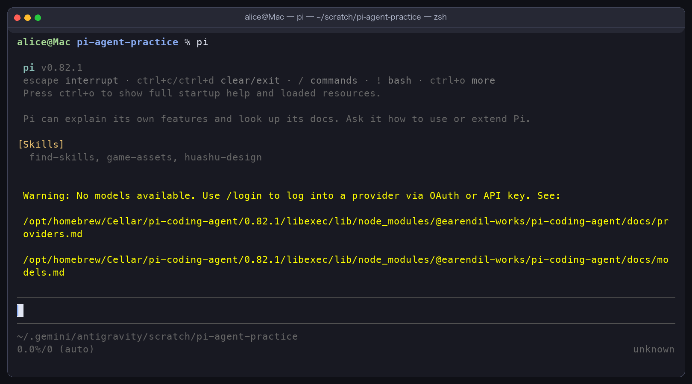

---

## 任务二：配置模型并完成一次会话

- 在 `~/.pi/agent/models.json` 中配置自定义提供商 `vita` 的接口地址、API Key（已做脱敏，不提交任何密钥、授权回调或 `auth.json`）及在线模型 `gpt-6-astra`、`gpt-6-luna`。
- 重新启动 `pi`，发送测试提示词：`你好。`
- 模型正常响应，底部状态栏显示当前工作目录、Token 用量以及当前使用的模型与思考级别（`gpt-6-astra • low`）。

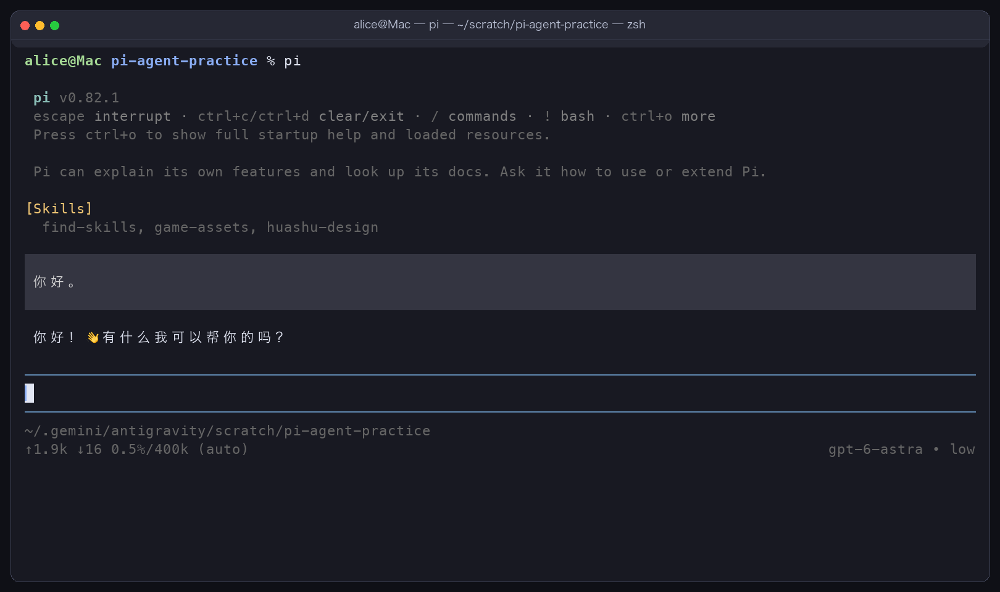

---

## 任务三：切换模型与模型思考级别

1. **切换模型**：
   - 在会话中按 `Ctrl+L`（或输入 `/model`）打开模型选择器，可以看到切换前当前选中模型为 `gpt-6-astra [vita] ✓`，另一可选模型为 `gpt-6-luna [vita]`，底部状态栏为 `gpt-6-astra • low`。
   - 选择 `gpt-6-luna` 并确认后，界面显示 `Model: gpt-6-luna`，随后发送短问题 `请用一句话解释持续集成。`，模型正常返回回答。
2. **切换思考级别**：
   - 使用 `Shift+Tab`（或输入 `/thinking`）将思考级别从 `low` 切换至 `high`，界面提示 `Thinking level: high`，底部状态栏同步更新为 `gpt-6-luna • high`。
   - 切换后发送问题 `为什么复杂代码重构适合使用较高思考级别？用一句话说明。`，模型结合推理能力给出回答。
3. **选择说明与任务复杂度影响**：
   - **模型选择**：`gpt-6-astra` 与 `gpt-6-luna` 均支持推理与视觉输入，日常轻量问答或快速确认可使用 `gpt-6-astra` 或 `gpt-6-luna` 搭配低思考级别以减少延迟。
   - **思考级别选择**：思考级别控制模型的推理深度（而非切换模型或仅隐藏思考文本）。简单问候、格式转换、事实查询适合 `low`/`off`，响应更快且 Token 开销更低；而复杂代码重构、多文件依赖分析与架构排查适合调高至 `high`，以换取更周全的边界与风险检查（同时会增加一定等待时间与用量）。

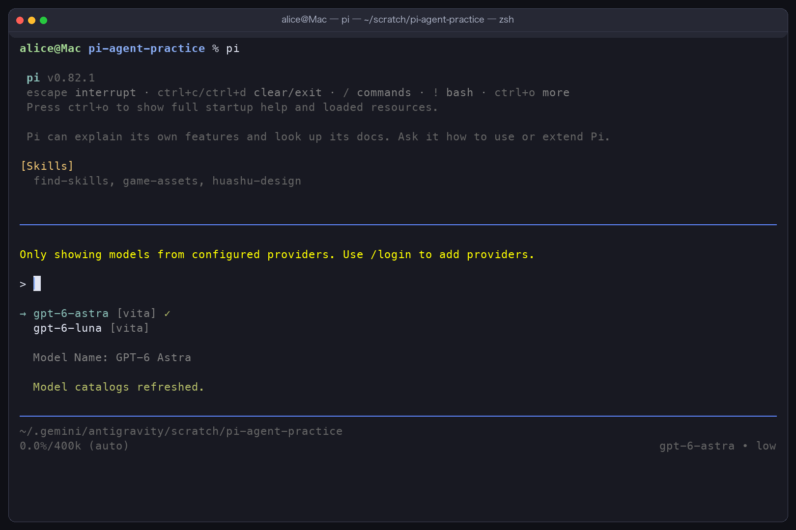

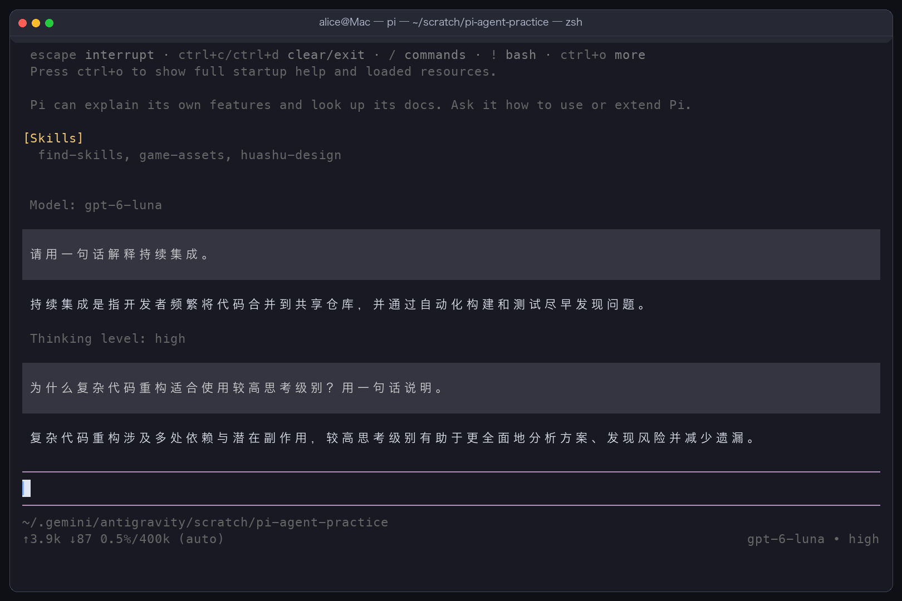

---

## 任务四：使用 `@` 引用代码文件并粘贴小图片测试

### A. 使用 `@` 引用代码文件

- 在工作目录创建测试代码文件 [`hello.py`](hello.py)：

```python
def add(a, b):
    return a + b

print(add(2, 3))
```

- 启动 `pi` 后输入 `@` 从候选列表中选中 `hello.py`，发送提示词：
  `请解释 @hello.py 的功能，说明运行后输出什么。只解释，不修改文件。`
- Pi 读取 `hello.py` 后准确解释了 `add(a, b)` 的两数相加功能，并给出运行输出为 `5`，且未修改原文件。

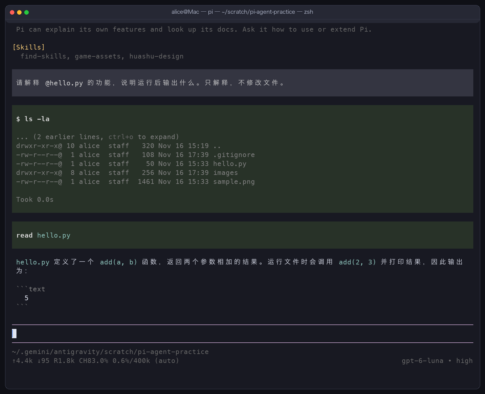

### B. 粘贴小图片并测试

- 准备 `200×200` 像素测试图片 [`sample.png`](sample.png)（白色背景、左侧蓝色实心正方形、右侧黑色数字 `7`）。
- 将图片内容复制到系统剪贴板后，在支持图像输入的模型（`input: ["text", "image"]`）会话中按 macOS 快捷键 `Ctrl+V` 粘贴，Pi 自动将剪贴板图片保存为临时 PNG 附件路径并附加到输入中，随后发送：
  `请描述图片中的颜色、形状和数字。`
- 模型读取图像后准确识别出：白色背景、左侧蓝色正方形、右侧黑色数字 `7`。

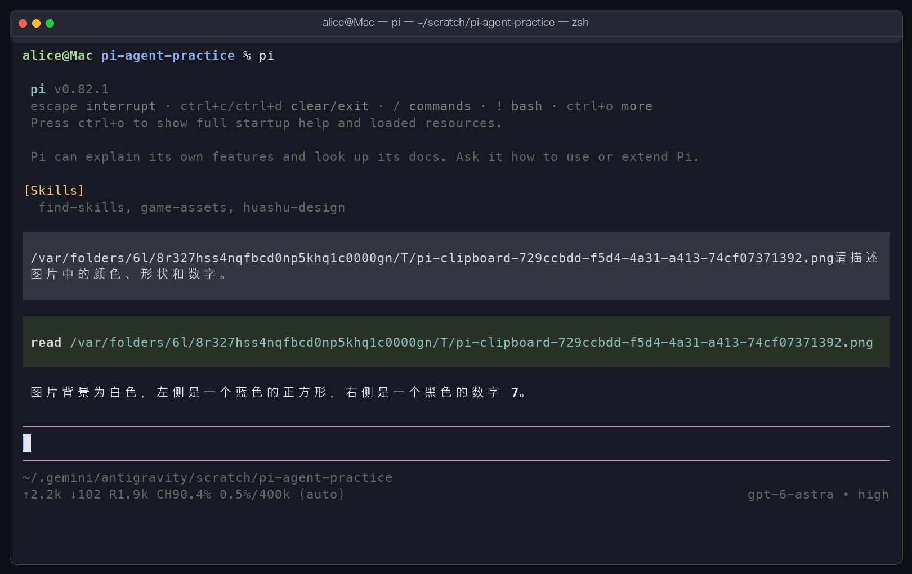

原始测试图片（200×200）：


---

## 任务五：从 Pi Packages 安装并使用插件

- **插件名称**：`pi-web-access`（v0.48.0）
- **来源**：Pi Packages（`https://pi.dev/packages`） / npm（`npm:pi-web-access`）
- **安装命令**：`pi install npm:pi-web-access`
- **作用与所需配置**：为 Pi 提供网页内容抓取、网页搜索（支持免密 Exa MCP 或可选配置第三方搜索 API Key）、GitHub 仓库访问及文档提取等能力；直接使用 `fetch_content` 抓取公开网页无需额外 API Key。
- **安装与加载验证**：
  1. 执行 `pi install npm:pi-web-access` 完成安装，并通过 `pi list` 核对已安装插件包。
  2. 完全退出旧会话后重新启动 `pi`，在启动信息 `[Extensions]` 区域可见 `pi-web-access:dist` 已加载。
  3. 发出试用指令：`请使用网页工具获取 https://example.com 的页面标题，并说明使用了什么工具。` Pi 首先尝试调用 `fetch_content` 抓取直连网页（因本机代理 TUN Fake-IP 段 `198.18.0.0/15` 被插件的 SSRF 防护拦截），随后自动改用 `web_search`（Exa 免密搜索通道）成功检索并确认页面标题为 `Example Domain`。

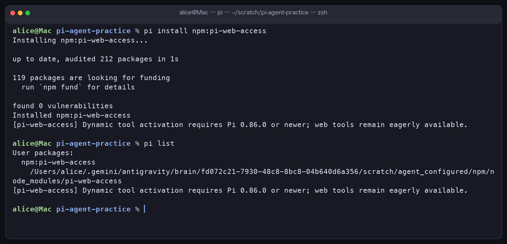

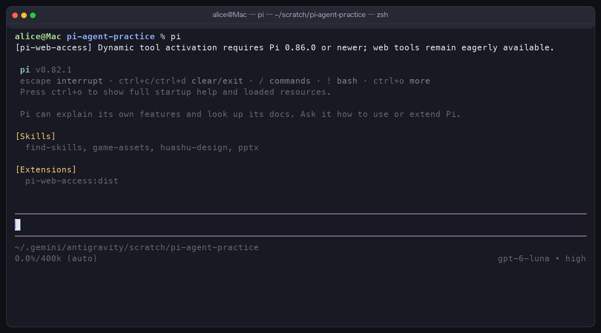

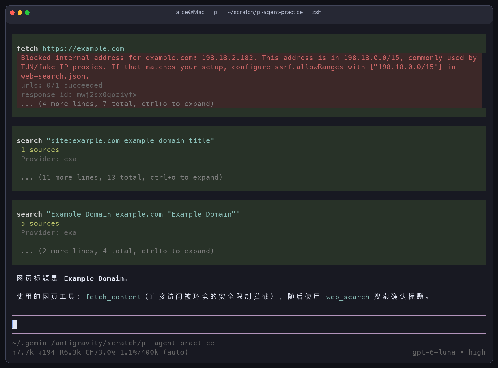

---

## 任务六：让 AI 安装 PPT Skill 并验证发现与调用（选做项）

- **Skill 来源**：`https://github.com/anthropics/skills` 仓库的 `skills/pptx` 目录
- **源 Commit**：`1780c5e5a552fd4d1c9d6a7b0cab26b0c2bef064`（同时记录于 [`PPTX-SKILL-SOURCE.txt`](PPTX-SKILL-SOURCE.txt) 与 [`.pi/skills/pptx/PPTX-SKILL-SOURCE.txt`](.pi/skills/pptx/PPTX-SKILL-SOURCE.txt)）
- **安装路径**：项目级目录 [`.pi/skills/pptx`](.pi/skills/pptx)
- **操作流程与验证**：
  1. 在 `pi-agent-practice` 目录启动 `pi`，向 AI 发送指令要求从 `anthropics/skills` 下载 `skills/pptx` 完整目录至 `.pi/skills/pptx`，保留 `SKILL.md`、`LICENSE.txt` 及 `scripts/` 等支持文件且记录源 commit，不修改其他项目、不自动安装依赖。
  2. 检查目录结构，确认 `.pi/skills/pptx/` 下完整包含 `SKILL.md`、`LICENSE.txt`、`PPTX-SKILL-SOURCE.txt` 及 `scripts/`（含 `add_slide.py`、`apply_theme.js`、`clean.py`、`slide_text.py`、`thumbnail.py`、`office/` 等）。
  3. 完全退出原会话并在 `pi-agent-practice` 重新启动 `pi`，启动页 `[Skills]` 列表已自动发现 `pptx`。
  4. 输入显式调用命令 `/skill:pptx 请说明这个 Skill 的名称、用途和所在目录。`，模型准确说明 Skill 名称为 `pptx`、用途为演示文稿（`.pptx`）创建/读取/编辑与检查，并指向本项目 `.pi/skills/pptx` 路径。

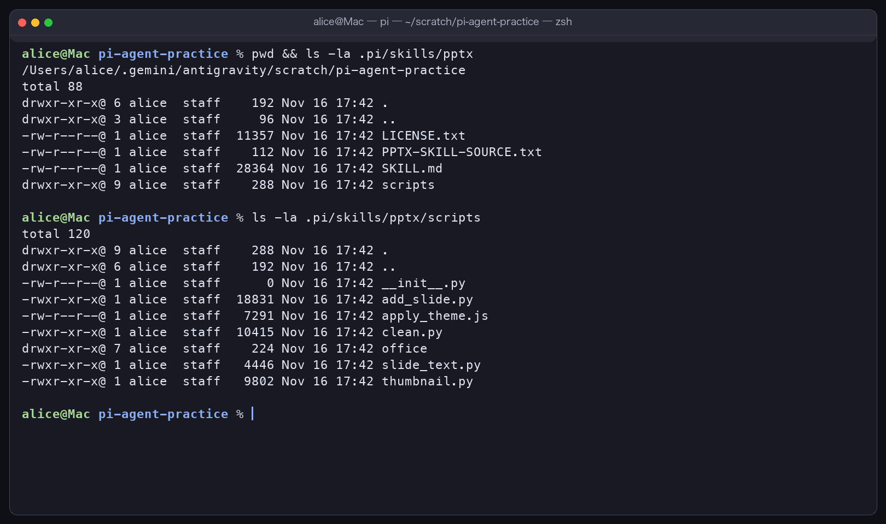

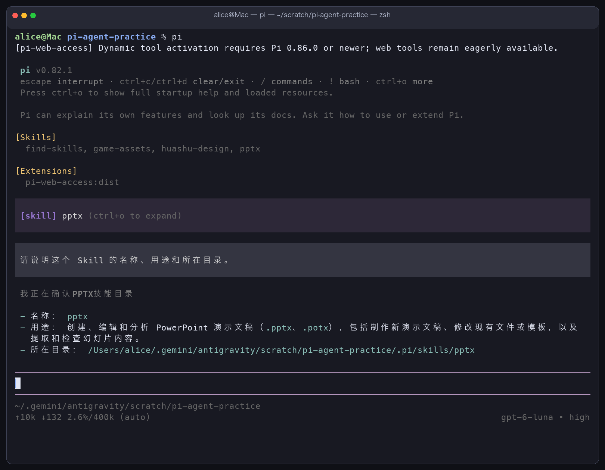

---

## 附件清单与隐私安全检查

- [`hello.py`](hello.py)：任务四 A 代码引用测试脚本。
- [`sample.png`](sample.png)：任务四 B 图片识别原始测试小图（200×200）。
- [`PPTX-SKILL-SOURCE.txt`](PPTX-SKILL-SOURCE.txt)：任务六 `pptx` Skill 来源与 Commit 记录。
- [`.pi/skills/pptx/`](.pi/skills/pptx)：任务六下载的项目级 PPT Skill 完整目录。
- `images/`：任务一至任务六全流程终端截图（`s1` ～ `s8`）。
- **安全检查**：仓库中未包含 `auth.json`、`models.json`、API Key 或任何个人授权凭证。
