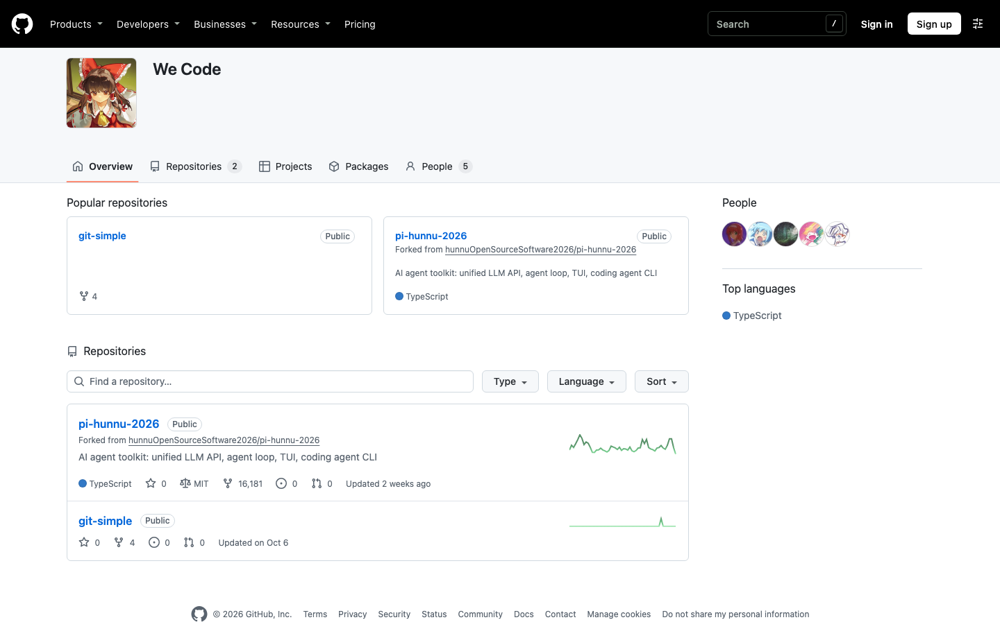
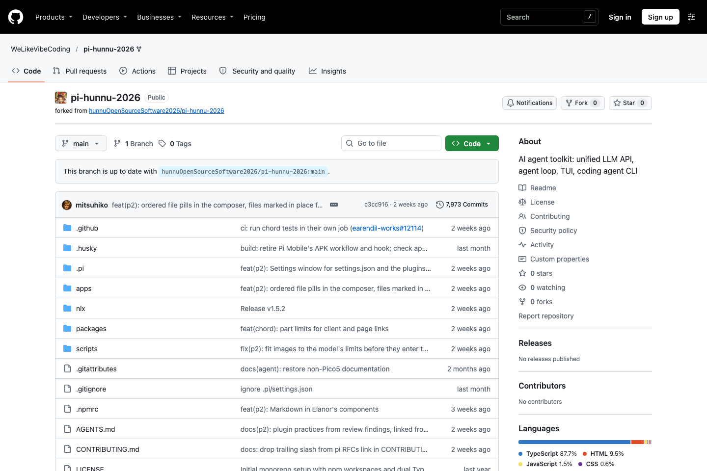
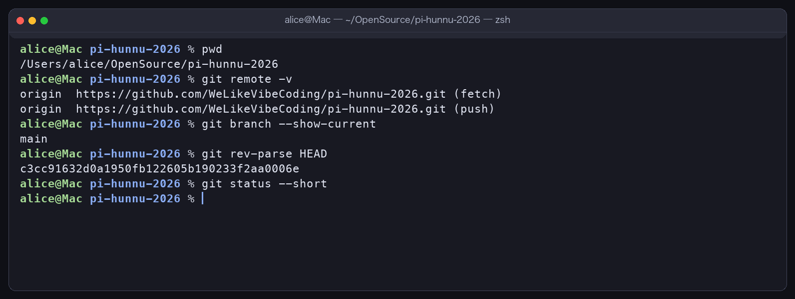
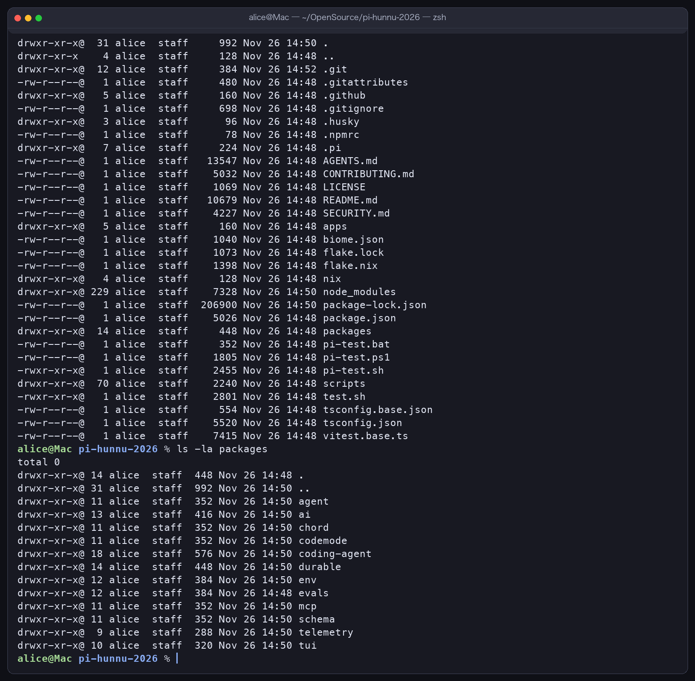
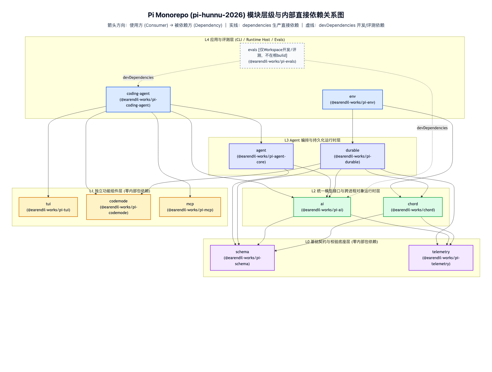
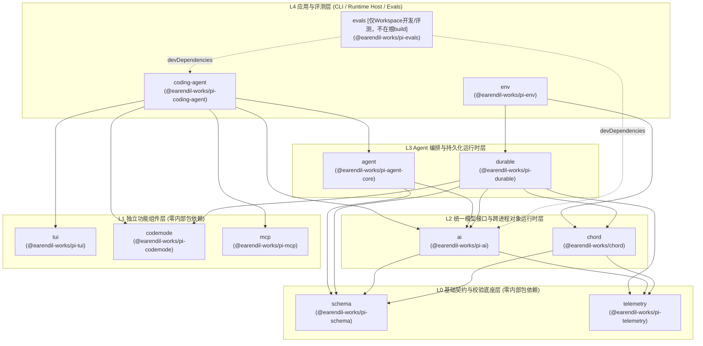

# 实践课 2：小组组织建仓与 Pi Agent 源码阅读

- **小组编号与角色**：第 26 组（组长：刘力阁 `LiuLige`）
- **GitHub 登录名**：`um-rs`
- **小组组织主页**：`https://github.com/WeLikeVibeCoding`
- **小组代码仓库地址**：`https://github.com/WeLikeVibeCoding/pi-hunnu-2026`
- **本人实际 Clone 地址**：`https://github.com/WeLikeVibeCoding/pi-hunnu-2026.git`
- **本地工作目录**：`/Users/alice/OpenSource/pi-hunnu-2026`（分支：`main`，完整提交号：`c3cc91632d0a1950fb122605b190233f2aa0006e`）
- **本人重点深入分析模块**：`coding-agent`、`agent`、`ai`、`schema`（完整 CLI → Agent 循环 → 统一模型接口 → 参数校验主链路），并核对了其余全部子包的构建配置与源码结构。

---

## 一、任务一：组长将课程仓库 Fork 到小组组织

1. 作为第 26 组组长，我将教师课程仓库 `hunnuOpenSourceSoftware2026/pi-hunnu-2026` Fork 到本组已建立的 GitHub Organization **`WeLikeVibeCoding`** 名下（而非个人账号 `um-rs` 下），仓库名称保留为 `pi-hunnu-2026`：
   - 小组组织仓库主页：`https://github.com/WeLikeVibeCoding/pi-hunnu-2026`
2. 核查组织成员与协作权限：本组 5 名成员（`um-rs`、`fugory`、`xiangsi-max`、`seteor-re`、`CirnoNine9`）均已加入 `WeLikeVibeCoding` 组织且公开可见，对 `WeLikeVibeCoding/pi-hunnu-2026` 均拥有完整的分支创建与 PR 协作权限，已将组织仓库地址同步给全体组员。





---

## 二、任务二：下载课程仓库源码并确认来源与版本

### 1. 建立全英文实验目录并克隆小组仓库

在本地全英文路径 `/Users/alice/OpenSource` 下，从第 26 组组织仓库克隆 `main` 分支源码：

```bash
cd /Users/alice/OpenSource
git clone --branch main https://github.com/WeLikeVibeCoding/pi-hunnu-2026.git
cd pi-hunnu-2026
```

### 2. 核验本地目录、远端地址、当前分支与完整提交编号

在仓库根目录执行校验命令（macOS `zsh` 环境下 `pwd` 对应 PowerShell 的 `Get-Location`）：

```bash
pwd
git remote -v
git branch --show-current
git rev-parse HEAD
git status --short
```

核验结果如下：
- **当前本地目录**：`/Users/alice/OpenSource/pi-hunnu-2026`
- **远端 `origin` 地址**：`https://github.com/WeLikeVibeCoding/pi-hunnu-2026.git`（fetch / push 均指向第 26 组组织内仓库）
- **当前分支**：`main`
- **完整提交编号（HEAD Commit SHA）**：`c3cc91632d0a1950fb122605b190233f2aa0006e`
- **工作区状态**：干净无未提交更改（`git status --short` 输出为空）



同时查看本地克隆后的仓库根目录及 `packages/` 子模块目录结构：



---

## 三、任务三：分析子模块功能与依赖关系

### 1. 仓库版本核对与目录差异说明

核对本地源码（`c3cc91632d0a1950fb122605b190233f2aa0006e`）根目录 `package.json` 与 `packages/` 目录：
- 根 `package.json` 的 `scripts.build` 依次构建 **11 个核心子包**，顺序与作业表格列出的 11 个文件夹完全一致：
  `telemetry` → `schema` → `chord` → `tui` → `codemode` → `mcp` → `ai` → `durable` → `env` → `agent` → `coding-agent`。
- **实际目录增减差异说明**：
  1. `packages/` 下实际共有 **12 个子文件夹**，除上述 11 个参与根构建的发布包（版本号均为 `1.5.2`）外，还多出一个私有评测包 **`packages/evals`**（`@earendil-works/pi-evals`，`"private": true`）。该包没有定义 `build` 脚本，而是通过 `node --experimental-strip-types src/cli.ts` 和 `vitest` 直接运行 TypeScript 评测脚本（由根 `npm run eval` 调用），因此不参与根 `npm run build`。
  2. 此外，根 `workspaces` 还声明了 `apps/*`（包含 `apps/p2`、`apps/p2-mac`、`apps/p3` 等上层应用工作区）以及 4 个示例工作区。

### 2. 子模块功能、构建行为与内部直接依赖分析表

下表按根 `package.json` 中 `scripts.build` 的实际执行顺序整理，逐一核对了各包的 `package.json`、`tsconfig.build.json` 与 `src/` 源码（本人重点深入研读了 **`schema`、`ai`、`agent`、`coding-agent`** 四个核心模块的实现细节）：

| 子文件夹（包名） | 代码主要实现什么功能 | 本模块 `build` 执行什么、生成什么 | 直接依赖哪些内部模块 | 依据文件或代码位置 |
| :--- | :--- | :--- | :--- | :--- |
| **`telemetry`**<br>`@earendil-works/pi-telemetry` | 提供与厂商无关的可观测性/遥测契约（Span、计数器、直方图指标）、内存采集器（`memory.ts`）、空实现（`noop.ts`）与指标渲染工具（`render.ts`）。 | 执行 `tsc -p tsconfig.build.json`，将 `src/**/*.ts` 编译输出到 `dist/`（生成 `.js`、`.d.ts` 及 `.js.map`）。 | **无**（零内部模块依赖，亦无外部运行时 `dependencies`） | `packages/telemetry/package.json`、`tsconfig.build.json`、`src/index.ts`、`src/metrics.ts` |
| **`schema`** ★<br>`@earendil-works/pi-schema` | 实现不使用 `eval`/`new Function`（兼容严格 CSP 环境）的高性能 JSON Schema（Draft 2020-12 / Draft 7）编译器与校验器，将 Schema 编译为纯闭包函数，并支持参数类型强制转换与错误解释。 | 执行 `tsc -p tsconfig.build.json`，将 `src/**/*.ts` 编译输出到 `dist/index.js`、`dist/formats/index.js` 及对应 `.d.ts` 类型声明。 | **无**（零内部模块依赖） | `packages/schema/package.json`、`src/compiler.ts`、`src/validator.ts`、`src/coerce.ts` |
| **`chord`**<br>`@earendil-works/chord` | 跨进程应用对象运行时框架：提供契约（`contracts`）、文档增量同步（`delta`/`sync`）、SQLite 存储适配、热重载插件系统、HTTP/Worker 通信及 React/TUI 客户端桥接。 | 执行 `tsc -p tsconfig.build.json`，编译多入口子路径模块至 `dist/`（含 `dist/index.js`、`dist/sqlite/`、`dist/node/`、`dist/web/` 等及 `.d.ts`）。 | `schema`、`telemetry`<br>（注：另有可选外部 `peerDependencies`：`esbuild`、`react`、`ws`） | `packages/chord/package.json`（L171-L190）、`src/contracts/`、`src/delta/`、`src/node/` |
| **`tui`**<br>`@earendil-works/pi-tui` | 终端用户界面（TUI）引擎：基于行列差分渲染（Differential Rendering）实现低闪烁终端界面，内置多行编辑器（`editor-component.ts`）、自动补全、快捷键绑定、Markdown/LaTeX 渲染及 macOS/Linux/Win32 原生剪贴板/修饰键扩展。 | 执行 `tsc -p tsconfig.build.json`，将 `src/**/*` 编译生成 `dist/index.js`、组件与 `.d.ts`（原生 `.node` 扩展由独立的 `build:native:{darwin,linux,win32}` 构建并预置在 `native/`）。 | **无**（仅依赖外部库 `get-east-asian-width`、`marked`、`marked-cjk-friendly`） | `packages/tui/package.json`、`src/editor-component.ts`、`src/layout.ts`、`native/` |
| **`codemode`**<br>`@earendil-works/pi-codemode` | 基于 `quickjs-wasi`（WebAssembly QuickJS 引擎）的沙箱化 JavaScript 执行环境：宿主将允许调用的工具注入沙箱，使模型生成的脚本只能在受控工具能力范围内执行，支持 Node Worker 与 Cloudflare 运行时。 | 执行 `tsc -p tsconfig.build.json`（含 `src/cloudflare-modules.d.ts` 环境声明），生成 `dist/index.js`、`dist/portable.js`、`dist/runtime/worker.js` 等产物。 | **无**（仅依赖外部库 `quickjs-wasi`） | `packages/codemode/package.json`、`tsconfig.build.json`、`src/wasm.ts`、`src/runtime/worker.ts` |
| **`mcp`**<br>`@earendil-works/pi-mcp` | 独立的 Model Context Protocol（MCP）客户端实现：负责连接外部 MCP Server（支持 stdio 管道与 HTTP/SSE 传输）、OAuth 授权认证、工具输入 Schema 转换及输出长度限制。 | 执行 `tsc -p tsconfig.build.json`，编译生成 `dist/index.js`、`dist/oauth/index.js`、`dist/testing/index.js` 及 `.d.ts`（注：`pipe.ts`/`content.ts` 仅在注释中提及 `pi-env`/`pi-ai`，无代码导入）。 | **无**（仅依赖外部库 `cross-spawn`） | `packages/mcp/package.json`、`src/client.ts`、`src/transports/`、`src/oauth/` |
| **`ai`** ★<br>`@earendil-works/pi-ai` | 统一多厂商大模型调用层（Unified LLM API）：封装 OpenAI、Anthropic、Google Gemini、AWS Bedrock 等流式协议适配器（`streamSimple`），管理模型目录、工具参数校验（调用 `pi-schema`）、Token 计费、OAuth 与图像缩放。 | 执行 `npm run generate-models && npm run build:offline`：① 运行 `node catalog/generate.ts --strict` 联网拉取并生成最新模型目录代码与 JSON 数据；② 运行 `check-model-data.ts` 校验模型数据；③ `tsc -p tsconfig.build.json` 编译 TS 到 `dist/`（含 `dist/cli.js`）；④ 清理并将 `src/providers/data` 复制到 `dist/providers/data`。 | `schema`、`telemetry` | `packages/ai/package.json`（L71-L91）、`catalog/generate.ts`、`src/providers/`、`src/compat.ts` |
| **`durable`**<br>`@earendil-works/pi-durable` | 持久化对话、后台任务与文档运行时：基于 `chord` 与 JSONL/SQLite/IndexedDB 存储后端，提供可恢复的长周期 Agent 会话、嵌套工具调度、工具搜索（`tool-search`）与服务端沙箱集成。 | 执行 `tsc -p tsconfig.build.json`（`paths` 映射 `../chord/dist/*.d.ts` 与 `../ai/dist/index.d.ts`），编译生成 `dist/index.js` 及 `storage/*`、`tools/*`、`env/*` 等子模块产物。 | `chord`、`ai`、`codemode`、`schema`、`telemetry` | `packages/durable/package.json`（L163-L170）、`tsconfig.build.json`、`src/session/`、`src/storage/` |
| **`env`**<br>`@earendil-works/pi-env` | 面向 `pi-durable` 的远程执行环境客户端与守护进程：通过 SSH 部署轻量级守护进程并提供 `ExecutionEnv` 客户端，实现远程进程执行、终端转发、文件枚举与监听。 | 默认 `build` 执行 `tsc -p tsconfig.build.json`（映射 `chord` 与 `durable` 的 `dist/*.d.ts`）生成 TS 客户端产物到 `dist/`；另提供可选 `build:daemon` 调用 `cargo build` 编译 Rust 守护进程。 | `chord`、`durable` | `packages/env/package.json`、`tsconfig.build.json`、`src/remote-env.ts`、`src/ssh.ts`、`daemon/Cargo.toml` |
| **`agent`** ★<br>`@earendil-works/pi-agent-core` | 通用有状态 Agent 核心引擎：维护对话消息状态（`AgentState`）、转向/追问队列（`steeringQueue` / `followUpQueue`）与事件订阅机制，在 `agent-loop.ts` 中驱动“请求模型 → 解析并并行/串行执行工具 → 将 `toolResult` 写回上下文继续循环”的核心闭环。 | 执行 `tsc -p tsconfig.build.json`（`paths` 指向 `../ai/dist/*.d.ts`），将 `agent.ts`、`agent-loop.ts`、`stream-fn.ts`、`proxy.ts`、`types.ts` 编译输出至 `dist/`。 | `ai`、`schema` | `packages/agent/package.json`、`tsconfig.build.json`、`src/agent.ts`、`src/agent-loop.ts` |
| **`coding-agent`** ★<br>`@earendil-works/pi-coding-agent` | 终端编程助手 CLI 主程序（`pi` 命令）：集成内置工具（`read`/`bash`/`edit`/`write`/`grep` 等）、JSONL 会话树持久化（`SessionManager`）、交互式 TUI 模式（`InteractiveMode`）/打印模式/RPC 模式、Skills/Extensions/MCP 插件体系。 | 执行 `npm run build:unbundled && node ../../scripts/build-coding-agent-bundle.mjs`：① `tsc -p tsconfig.build.json` 编译源码至 `dist/`；② 为 `dist/cli.js` 和 `dist/rpc-entry.js` 添加可执行权限；③ 复制主题 JSON、PNG 资源及 HTML 导出模板到 `dist/`；④ 调用 `esbuild` 将 CLI 打包为 `dist/bundle/cli.js`（共 84 个文件，约 9.4 MiB，`bin.pi` 入口）。 | `agent`、`ai`、`codemode`、`mcp`、`tui` | `packages/coding-agent/package.json`（L30-L66）、`scripts/build-coding-agent-bundle.mjs`、`src/main.ts`、`src/core/agent-session.ts` |
| *(补充差异)* **`evals`**<br>`@earendil-works/pi-evals` | 仓库内置的自动化评测套件（私有工作区包）：在宿主机或 Docker 环境中对 `coding-agent` 与模型行为运行基准测试并生成报告。 | **无 `build` 脚本**（不参与根 `npm run build`）；通过 `vitest` 或 Node 原生类型剥离（`--experimental-strip-types`）直接执行源码。 | 无生产 `dependencies`；**`devDependencies`** 依赖 `ai`、`coding-agent` | `packages/evals/package.json`、`src/harness.ts`、根 `package.json` `scripts.eval` |

---

### 3. 模块层级与依赖关系图（含分层依据与可编辑图源）

#### （1）层级划分依据
根据各包 `package.json` 中的内部依赖拓扑深度（DAG 最长路径层级）与职责边界，全仓子包可清晰划分为五层（箭头方向统一为 **使用方 Consumer → 被依赖方 Dependency**）：
- **L0 基础契约与校验底座层（`schema`、`telemetry`）**：不依赖仓库内任何其他包，也不绑定具体业务场景，为全仓提供 JSON Schema 闭包校验与遥测接口标准。
- **L1 独立功能组件层（`tui`、`codemode`、`mcp`）**：同样不依赖仓库内任何其他内部包，分别聚焦单一正交职责（终端差分渲染 UI、QuickJS WASM 沙箱执行、MCP 客户端协议），可独立编译与复用。
- **L2 统一模型接口与跨进程运行时层（`ai`、`chord`）**：直接建立在 L0（`schema` + `telemetry`）之上，分别提供统一多模型流式调用能力与跨进程状态/插件运行时。
- **L3 Agent 编排与持久化会话层（`agent`、`durable`）**：在 L2 与 L1 组件之上封装多轮工具调用状态机（`agent` 依赖 `ai`、`schema`）以及可持久化的任务/对话编排运行时（`durable` 依赖 `chord`、`ai`、`codemode`、`schema`、`telemetry`）。
- **L4 应用入口与环境扩展层（`coding-agent`、`env`，以及开发评测包 `evals`）**：位于依赖链最顶端的面向终端用户或部署环境的宿主程序（`coding-agent` 汇聚 `agent`、`ai`、`tui`、`codemode`、`mcp` 生成最终 `pi` CLI；`env` 扩展 `durable` + `chord` 的远程 SSH 执行环境；`evals` 通过 `devDependencies` 对 `coding-agent` 与 `ai` 进行评测，图中以虚线明确区分）。

#### （2）渲染效果图与可编辑 Mermaid 图源

- 独立可编辑图源文件：[module-dependencies.mmd](module-dependencies.mmd)





---

### 4. 结合源码回答三个问题

#### 问题 1：根目录与子模块中的 `npm run build` 分别读取什么配置、执行什么工作？
1. **根目录 `npm run build`**：
   - 读取**仓库根目录的 `package.json`** 中的 `scripts.build` 字段。
   - 它本身不直接调用 `tsc`，而是充当 **Monorepo 构建编排器**：通过 `&&` 短路串联命令，按预设拓扑顺序依次 `cd` 进入 `packages/telemetry`、`schema`、`chord`、`tui`、`codemode`、`mcp`、`ai`、`durable`、`env`、`agent`、`coding-agent` 共 11 个子目录，逐个触发子包自己的 `npm run build`；任一前置子包返回非 0 退出码时立即中止后续构建。
2. **各子模块中的 `npm run build`**：
   - 先读取**各自子包目录下的 `package.json`** 的 `scripts.build` 字段，再由其中的编译器或脚本读取**子包的 `tsconfig.build.json`**（各子包 `tsconfig.build.json` 均通过 `"extends": "../../tsconfig.base.json"` 继承根级公共编译选项，并覆盖各自的 `rootDir`、`outDir` 及指向已编译上游包 `../<dep>/dist/*.d.ts` 的 `paths`）。
   - 执行的具体工作分为三类：
     - **纯 TypeScript 编译型（9 个包）**：`telemetry`、`schema`、`chord`、`tui`、`codemode`、`mcp`、`durable`、`env`、`agent` 执行 `tsc -p tsconfig.build.json`，将 `src/` 编译为 `dist/` 下的 `.js` 和 `.d.ts`。
     - **代码/数据生成 + 编译 + 资源拷贝型（`ai` 包）**：先运行 `node catalog/generate.ts --strict` 拉取并生成模型目录代码与元数据，经 `scripts/check-model-data.ts` 校验通过后执行 `tsc -p tsconfig.build.json`，最后调用 `scripts/package-files.mjs` 将 `src/providers/data` 同步至 `dist/providers/data`。
     - **编译 + 权限与静态资源处理 + Bundle 打包型（`coding-agent` 包）**：先执行 `tsc -p tsconfig.build.json`，随后将 `dist/cli.js`、`dist/rpc-entry.js` 设为可执行，拷贝交互式主题 JSON、PNG 图标与 HTML 导出模板到 `dist/`，最后执行 `node ../../scripts/build-coding-agent-bundle.mjs`（底层调用 `esbuild`）生成独立 CLI 产物目录 `dist/bundle/`（入口为 `dist/bundle/cli.js`）。

#### 问题 2：构建顺序和模块依赖有什么关系？相邻构建的模块是否一定互相依赖？
1. **构建顺序与模块依赖的关系**：
   - 构建顺序是内部依赖有向无环图（DAG）在“**被依赖方先于使用方**”约束下的一个**逆向拓扑排序（Topological Sort）**。
   - 从源码配置看，这不仅是运行时加载的需要，更是编译期类型检查的硬性要求：例如 `packages/agent/tsconfig.build.json` 中显式配置了 `"@earendil-works/pi-ai": ["../ai/dist/index.d.ts"]`，`packages/coding-agent/tsconfig.build.json` 显式指向 `../agent/dist/index.d.ts`、`../ai/dist/index.d.ts` 和 `../tui/dist/index.d.ts`。如果上游包尚未构建生成 `dist/*.d.ts`，下游包执行 `tsc` 时就会直接报找不到模块声明错误。
2. **相邻构建的模块不一定互相依赖**：
   - 因为模块依赖关系是一个**偏序集（DAG）**，而 shell 脚本中的 `&&` 序列必须将其展平为一条**全序线性序列**，所以排在相邻位置的两个包完全可能处于互不相干的平行分支上。源码中有多处典型例证：
     - `telemetry` → `schema`：两者都是零内部依赖的 L0 底座包，彼此完全独立，交换顺序不影响构建。
     - `chord` → `tui` → `codemode` → `mcp`：`tui`、`codemode`、`mcp` 均无任何内部模块依赖，它们既不依赖前一个构建的 `chord`，彼此之间也互不依赖。
     - `env` → `agent`：`env` 属于持久化远程环境分支（`env → durable → chord`），而紧随其后的 `agent` 仅依赖 `ai` 和 `schema`，**完全不依赖 `env` 或 `durable`**（同理，最后构建的 `coding-agent` 也完全不依赖 `chord`、`durable`、`env`）。

#### 问题 3：选择一条涉及至少三个模块的依赖路径，说明这些模块如何分工
选择本人重点分析的四模块核心调用链：**`coding-agent` → `agent` → `ai` → `schema`**，它们在一轮包含工具调用的真实对话中各司其职、边界清晰：

1. **`coding-agent`（交互宿主、会话持久化与具体工具实现层）**：
   - 在 `src/main.ts`、`src/modes/interactive/interactive-mode.ts` 与 `src/core/agent-session.ts` 中，负责解析命令行参数、管理终端 TUI 界面、维护 `.jsonl` 会话历史（`SessionManager`），并创建具体的文件系统与系统工具实例（如 `src/core/tools/read.ts` 中的 `read`、`bash`、`edit`、`write`）。它不自己手写循环调度或底层 HTTP 请求，而是把消息列表、工具定义和 `streamSimple` 注入 `agent` 模块的 `Agent` 实例，调用 `this.agent.prompt(messages)` 启动运行。
2. **`agent`（多轮对话状态机与工具编排执行层）**：
   - 在 `packages/agent/src/agent.ts` 与 `src/agent-loop.ts` 中，维护与具体 UI 无关的 `AgentState` 和事件流（`turn_start`、`message_update`、`tool_execution_start`、`turn_end`）。`runLoop()` 调用 `streamAssistantResponse()` 获取模型回复后，自动筛选出 `toolCall` 内容块，在 `executeToolCalls()` 中串行或并行调用工具的 `execute()` 方法，将返回的 `ToolResultMessage` 压入 `currentContext.messages` 并自动发起下一轮模型请求，直到模型不再请求工具为止。
3. **`ai`（统一多模型协议适配与流式传输层）**：
   - 在 `packages/ai/src/` 中屏蔽 OpenAI、Anthropic、Gemini、Bedrock 等不同模型厂商的请求报文、SSE 流式分片、思考预算（Thinking Level）和认证头差异，对外暴露统一的 `streamSimple(model, llmContext, options)` 流式事件接口；同时在工具执行前提供 `validateToolArguments()`，桥接到底层校验器验证模型生成的 JSON 参数是否合法。
4. **`schema`（无 `eval` 的工具参数 JSON Schema 编译与校验底座）**：
   - 在 `packages/schema/src/compiler.ts` 与 `validator.ts` 中，将每个工具声明的参数 JSON Schema 预编译为纯 JavaScript 校验闭包。当 `ai` 层收到模型流式拼装完成的 `toolCall.arguments` 时，交由 `schema` 做严格类型校验、默认值填充与错误定位，防止残缺或越界参数直接进入 `coding-agent` 的本地文件/命令工具执行。
