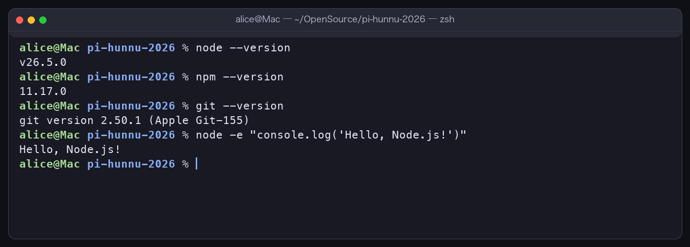
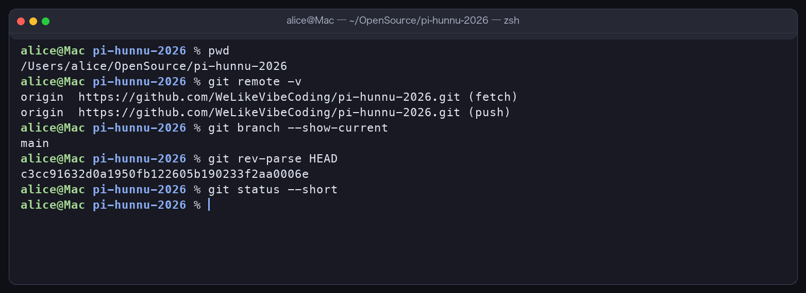
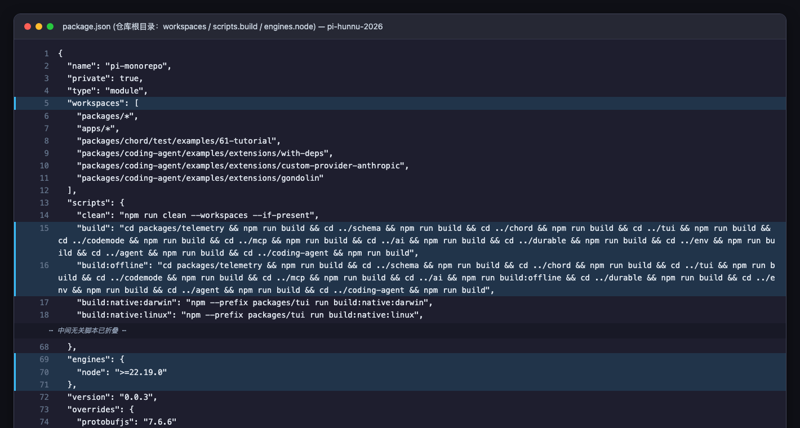
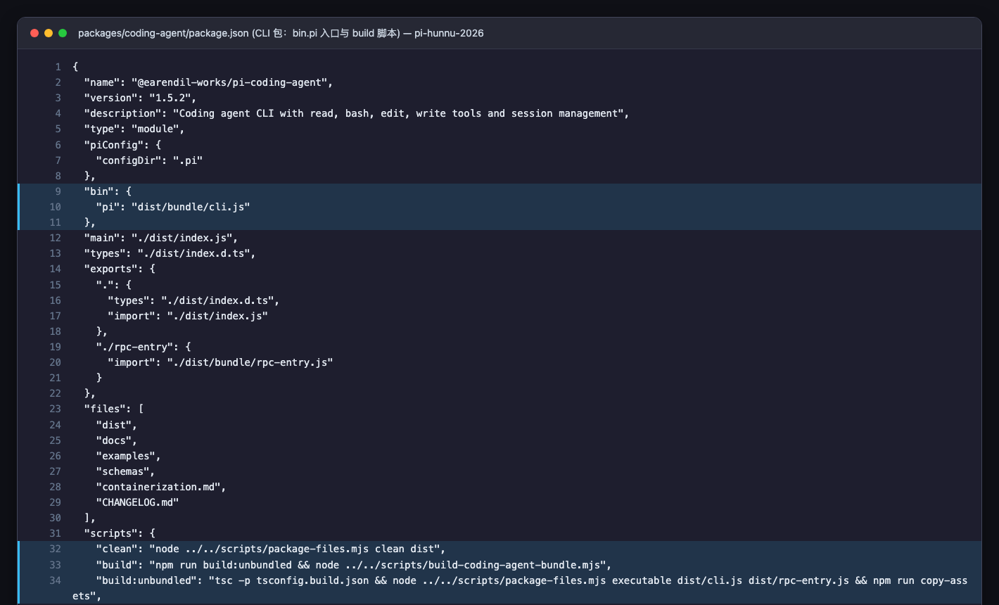
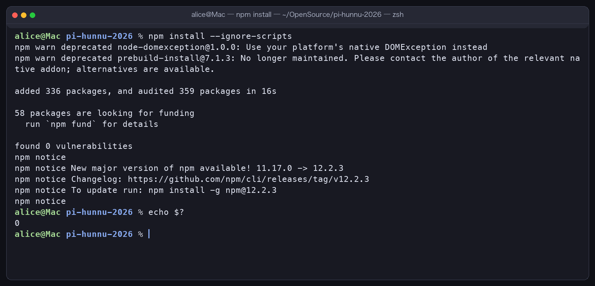
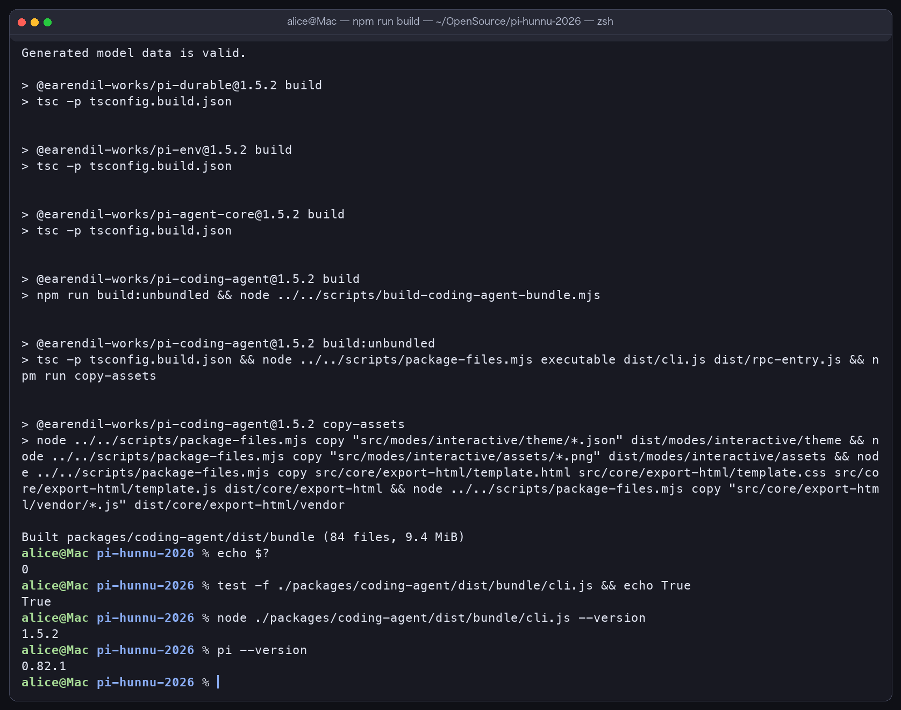
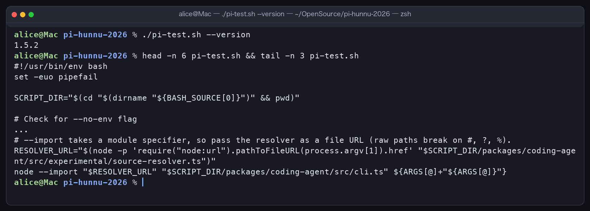
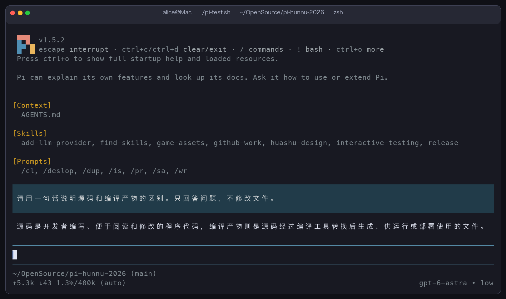
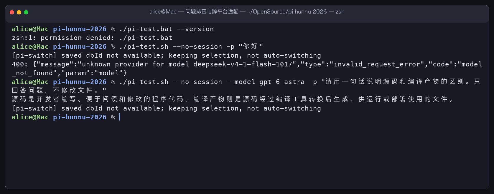

# 实践课 3：Pi Agent 源码获取、依赖安装与本地编译实验报告

- **小组编号与角色**：第 26 组（组长：刘力阁 `LiuLige`）
- **GitHub 登录名**：`um-rs`
- **小组代码仓库地址**：`https://github.com/WeLikeVibeCoding/pi-hunnu-2026`
- **本地源码目录**：`/Users/alice/OpenSource/pi-hunnu-2026`（分支：`main`，提交号：`c3cc91632d0a1950fb122605b190233f2aa0006e`）
- **实验环境**：macOS（Apple Silicon），`zsh`，Node.js `v26.5.0`，npm `11.17.0`，Git `2.50.1`

---

## 本次完成的六项核心任务概览

1. 检查并核实本机 Node.js、npm 和 Git 实际版本，验证 Node 运行环境并截图（**S1**）。
2. 从第 26 组组织仓库 `WeLikeVibeCoding/pi-hunnu-2026` 获取源码，核验目录、远端、分支与完整 Commit SHA 并截图（**S2**）。
3. 阅读根 `package.json` 与 `packages/coding-agent/package.json`，确认 `engines.node`、`workspaces`、`scripts.build` 与 `bin.pi` 的配置依据并截图（**S3**）。
4. 在仓库根目录执行 `npm install --ignore-scripts` 安装工作区依赖，记录退出码、区分弃用警告与错误并截图（**S4**）。
5. 执行首次 `npm run build` 完成全仓编译，验证退出码 `0`、检查 `dist/bundle/cli.js` 产物并与全局旧版 `pi`（`0.82.1` vs 本地 `1.5.2`）对比验证（**S5**），再通过 `./pi-test.sh` 启动本地源码完成真实会话（**S6**）。
6. 完整记录实验过程中遇到的跨平台命令差异与默认模型失效 `400 model_not_found` 问题及排查解决全过程（**S7，重点**）。

---

## 任务一：实验准备——检查和确认开发工具

在终端逐条执行版本检查与最小运行验证命令：

```bash
node --version
npm --version
git --version
node -e "console.log('Hello, Node.js!')"
```

本机实测版本与课程要求对照如下：

| 工具 | 本次实验用途 | 仓库要求 / 课程建议 | 本机实际版本 | 是否满足 |
| :--- | :--- | :--- | :--- | :---: |
| **Node.js** | 运行 JS/TS 脚本、TypeScript 编译器与打包脚本 | 根 `package.json` 声明 `>=22.19.0`（建议 Node 24+） | `v26.5.0` | ✓（同时满足子工作区如 `apps/p3` 的 `>=24.4.0` 要求，无 `EBADENGINE` 警告） |
| **npm** | 解析 `package-lock.json`、关联 workspaces、执行构建脚本 | 随 Node.js 附带版本 | `11.17.0` | ✓ |
| **Git** | 从小组组织仓库克隆并校验源码版本 | 能正常执行 `git --version` | `git version 2.50.1 (Apple Git-155)` | ✓ |



---

## 任务二：下载课程仓库源码并核验来源版本

在全英文工作目录 `/Users/alice/OpenSource` 下，从第 26 组组织内 Fork 的仓库 `WeLikeVibeCoding/pi-hunnu-2026` 克隆 `main` 分支源码并校验状态：

```bash
pwd
git remote -v
git branch --show-current
git rev-parse HEAD
git status --short
```

核验确认：
- **源码所在位置**：`/Users/alice/OpenSource/pi-hunnu-2026`
- **`origin` 远端地址**：`https://github.com/WeLikeVibeCoding/pi-hunnu-2026.git`（指向本组组织仓库）
- **当前分支与提交号**：`main` 分支，完整 Commit SHA 为 `c3cc91632d0a1950fb122605b190233f2aa0006e`，工作区干净。



---

## 任务三：阅读配置，确认安装与编译的依据

打开仓库根目录 `package.json` 与 CLI 子包 `packages/coding-agent/package.json` 核查关键配置项：





### 问题回答（用自己的话总结）

1. **Node.js 版本要求定义在哪里？**
   - 定义在仓库根目录 `package.json` 第 69–71 行的 `"engines": { "node": ">=22.19.0" }` 字段中（各子包 `packages/*/package.json` 也同步声明了 `>=22.19.0`，而 `apps/p3/package.json` 进一步要求 `>=24.4.0`）。本机 `v26.5.0` 同时满足根仓库与所有工作区子包的引擎约束。
2. **`npm run build` 实际从哪里读取命令、执行什么逻辑？**
   - 在根目录执行 `npm run build` 时，npm 读取**根 `package.json` 第 15 行的 `scripts.build`**。该命令并非 npm 内置的固定编译流程，而是由项目维护者编写的一串以 `&&` 连接的子目录构建链：依次进入 `telemetry`、`schema`、`chord`、`tui`、`codemode`、`mcp`、`ai`、`durable`、`env`、`agent`、`coding-agent` 共 11 个子包执行各自的 `npm run build`。
   - 由于仓库通过根 `package.json` 第 5–12 行的 `"workspaces"` 统一管理多包依赖，依赖锁文件集中在根目录 `package-lock.json` 中，因此必须在仓库根目录统一安装和按拓扑顺序编译，不能在单个子包里单独生成锁文件或乱序构建。

---

## 任务四：安装项目依赖

在仓库根目录 `/Users/alice/OpenSource/pi-hunnu-2026` 执行：

```bash
npm install --ignore-scripts
echo $?
```



### 安装过程与输出分析

1. **命令具体完成了什么工作？**
   - 根据根 `package.json`、`package-lock.json` 以及 `workspaces` 声明，解析并下载了 336 个外部依赖包到根目录 `node_modules/`（共审计 359 个包，耗时 16s），同时在 `node_modules/@earendil-works/*` 下为工作区内部子包建立符号链接（symlink），使各子包之间可以直接按包名互相引用。
   - `--ignore-scripts` 参数显式跳过了依赖安装阶段自动执行的生命周期钩子（如根 `package.json` 中的 `"prepare": "husky"` 以及第三方包的 `postinstall` 脚本），既避免了未编译状态下生命周期脚本报错，又提升了安全性，且完全不影响后续手动运行 `npm run build`。
   - 此处未使用 `-g`，因此依赖仅安装在当前项目目录内，**不会覆盖或替换**本机在第一次实践课通过 Homebrew 全局安装的 `/opt/homebrew/bin/pi`（`v0.82.1`）。
2. **区分警告（Warning）、通知（Notice）与致命错误（Error）**：
   - **退出码验证**：紧接着执行 `echo $?` 输出 **`0`**，证明依赖安装命令完整成功，没有任何导致中断的致命错误。
   - **`EBADENGINE` 检查**：未出现任何 `EBADENGINE` 引擎版本不匹配警告（验证了 Node `v26.5.0` 满足全部依赖包要求）。
   - **`deprecated` 弃用提示**：输出了两条 `npm warn deprecated`（`node-domexception@1.0.0` 与 `prebuild-install@7.1.3`），这是传递依赖树中历史包维护状态的提示，并非安装失败。
   - **安全审计与版本通知**：审计结果为 **`found 0 vulnerabilities`**（无需也不应盲目运行会破坏锁文件版本的 `npm audit fix --force`）；末尾的 `npm notice` 仅为 npm 自身有新大版本可升级的提示信息。

---

## 任务五：本地编译与构建产物验证

在仓库根目录执行首次全量构建：

```bash
npm run build
echo $?
test -f ./packages/coding-agent/dist/bundle/cli.js && echo True
node ./packages/coding-agent/dist/bundle/cli.js --version
pi --version
```



### 构建过程与产物核验说明

1. **联网生成模型目录数据 vs 大模型权重**：
   - 构建进入 `packages/ai` 时执行了 `npm run generate-models`（即 `node catalog/generate.ts --strict`），联网拉取了 OpenAI、Anthropic、Google、OpenRouter、DeepSeek、Moonshot 等各平台的**模型名称、上下文窗口、支持模态与计费元数据**，并经 `check-model-data.ts` 打印 `Generated model data is valid.`。这只是客户端的模型配置目录数据，**绝不是把大模型权重下载到本机**。
2. **最终产物与版本核对**：
   - 构建最后一步由 `packages/coding-agent` 调用 `tsc`、拷贝静态资源并运行 `scripts/build-coding-agent-bundle.mjs`，输出 `Built packages/coding-agent/dist/bundle (84 files, 9.4 MiB)`，退出码 `echo $?` 为 **`0`**。
   - 检查 `packages/coding-agent/package.json` 中 `bin.pi` 指向的入口文件 `./packages/coding-agent/dist/bundle/cli.js` 存在（输出 `True`）。
   - 用 `node ./packages/coding-agent/dist/bundle/cli.js --version` 运行本地构建产物得到 **`1.5.2`**；而对比本机全局 `pi --version` 输出为第一次实践课安装的 **`0.82.1`**——版本号的明确差异进一步佐证了当前执行的是刚在本地编译出的最新源码产物。
   - 首次联网构建生成有效模型数据后，后续仅修改本地源码时即可使用 `npm run build:offline` 跳过联网拉取步骤、直接复用本地模型目录数据加速重编。

---

## 任务六：启动本地源码版本并完成一次会话

### 1. 验证本地源码直接启动入口 `./pi-test.sh`

查看仓库根目录脚本可知：Windows 下的 `pi-test.bat` 内部调用 `pi-test.ps1`，而在 macOS / Linux 下仓库提供了完全等价的 Bash 入口 **`./pi-test.sh`**。两者核心原理一致：先将 `packages/coding-agent/src/experimental/source-resolver.ts` 转为 `file://` URL 通过 `node --import` 注入，再直接加载运行 TypeScript 源码入口 `packages/coding-agent/src/cli.ts`。

执行 `./pi-test.sh --version`，输出 **`1.5.2`**：



### 2. 启动本地源码交互界面并完成真实问答

在仓库根目录执行 `./pi-test.sh` 启动本地源码版交互式 TUI，在输入框发送：

```text
请用一句话说明源码和编译产物的区别。只回答问题，不修改文件。
```

界面顶部清晰显示版本号 **`pi v1.5.2`**，底部状态栏显示当前源码目录 `/Users/alice/OpenSource/pi-hunnu-2026` 与模型 `gpt-6-astra • low`，模型准确返回一句话回答且未修改任何文件（截图已确保不暴露任何 API Key 或 `auth.json` 内容）：



### 3. 报告说明：如何确保运行的是本地源码？两种入口分别适合什么场景？

1. **本次如何确保运行的是本地源码而非全局版本？**
   - **显式相对路径调用**：未直接输入从系统 `PATH` 查找的 `pi`，而是显式执行当前仓库根目录下的 `./pi-test.sh`（底层执行 `node --import .../source-resolver.ts .../packages/coding-agent/src/cli.ts`）或 `node ./packages/coding-agent/dist/bundle/cli.js`。
   - **版本号交叉印证**：本机全局 `/opt/homebrew/bin/pi` 版本为 `0.82.1`，而通过 `./pi-test.sh` 与 `dist/bundle/cli.js` 启动时，命令行 `--version` 和 TUI 顶部标题均显示当前仓库源码版本 **`1.5.2`**，尽管它复用了 `~/.pi/agent` 下的模型配置，但执行的程序代码 100% 来自 `/Users/alice/OpenSource/pi-hunnu-2026`。
2. **源码入口（`./pi-test.sh` / `.\pi-test.bat`）与编译产物入口（`dist/bundle/cli.js` / `dist/cli.js`）分别适合什么场景？**
   - **源码入口（`./pi-test.sh`）**：通过自定义 ESM module loader（`source-resolver.ts`）结合 Node 原生 TypeScript 支持直接运行 `src/*.ts` 源码，**适合日常高频修改 `coding-agent` 源码、快速调试功能逻辑的场景**，改完 `src/` 无需每次等待完整 `tsc` + `esbuild` 打包即可立即验证效果。
   - **编译产物入口（`node ./packages/coding-agent/dist/bundle/cli.js` 或 `dist/cli.js`）**：运行经过 `tsc` 类型检查、静态资源拷贝与 `esbuild` 打包后的真实构建产物，**适合验证完整构建流水线是否通过、检查跨包编译产物（如修改了上游 `packages/agent` 后重新 `npm run build`）、模拟最终用户安装运行环境及发布前验收的场景**。

---

## 七、所遇到的困难与解决过程（重点）

在本次实验推进过程中，我遇到了 **2 个真实的环境与配置问题**，没有把它们混同于“编译失败”，而是逐一定位根因并解决：



### 困难 1：课程指导书中的 `.\pi-test.bat` 与 PowerShell 命令在 macOS 下无法直接执行
- **现象**：直接在 macOS `zsh` 终端运行 `./pi-test.bat --version` 时，由于 `.bat` 首行为 Windows 批处理指令 `@echo off` 且带有 CRLF 换行及 `setlocal` / `where powershell.exe` 语法，系统报错 `zsh: permission denied`（或用 `sh` 执行时报 `@echo: command not found`）；同时指导书中的 `Get-Location`、`Test-Path`、`$LASTEXITCODE` 也都是 PowerShell 专属语法。
- **排查与解决**：检查仓库根目录文件列表后发现，项目官方已经为类 Unix 环境配套提供了同名的 **`./pi-test.sh`** 脚本。对比阅读 `pi-test.ps1` 与 `pi-test.sh` 源码后确认：两者都把 `packages/coding-agent/src/experimental/source-resolver.ts` 转换为 `file://` URL 传给 `node --import`，再启动 `packages/coding-agent/src/cli.ts`。因此在 macOS 下统一改用 `./pi-test.sh`、用 `pwd` / `test -f` / `echo $?` 对应替代 PowerShell 命令，验证结果完全等价。

### 困难 2：首次用 `./pi-test.sh` 发起对话时遭遇 `[pi-switch]` 告警与 `400 model_not_found` 模型调用报错
- **现象**：本地编译完全成功（`--version` 正常输出 `1.5.2`），说明**本地源码程序已构建并启动成功**；但第一次直接运行 `./pi-test.sh --no-session -p "你好"` 测试对话时，终端先后打印：
  1. `[pi-switch] saved dbId not available; keeping selection, not auto-switching`
  2. `400: {"message":"unknown provider for model deepseek-v4-1-flash-1017","type":"invalid_request_error","code":"model_not_found","param":"model"}`
- **根因分析**：按照指导书任务六提示，将“本地程序启动”与“远程模型服务调用”拆开排查。检查复用的用户配置目录 `~/.pi/agent/` 发现：`settings.json` 中残留了旧版插件 `npm:pi-ccs` 的 `piSwitchSelection` 记录以及已下线的旧默认模型 `deepseek-v4-1-flash-1017`，导致本地客户端虽然成功启动并发出了 HTTP 请求，但远端自定义 API 网关拒绝了该失效模型 ID。
- **解决过程**：核对 `~/.pi/agent/models.json` 中当前在线可用的模型列表（`gpt-6-astra`、`gpt-6-luna`），显式指定在线模型 `--model gpt-6-astra`（或在交互界面 `/model` / 配置中将默认模型更新为 `gpt-6-astra`）后重新发送提示词，模型立即正常返回了准确回答，问题彻底解决。
