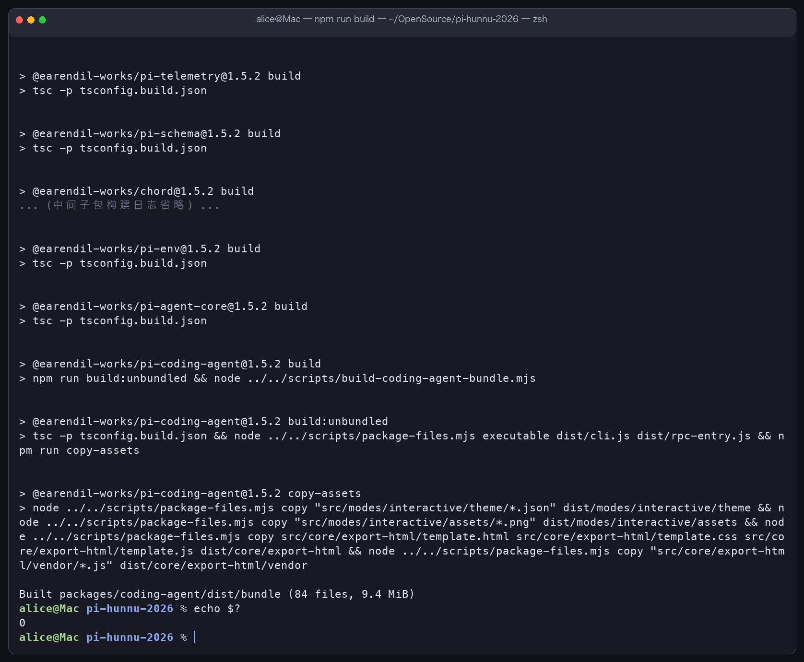
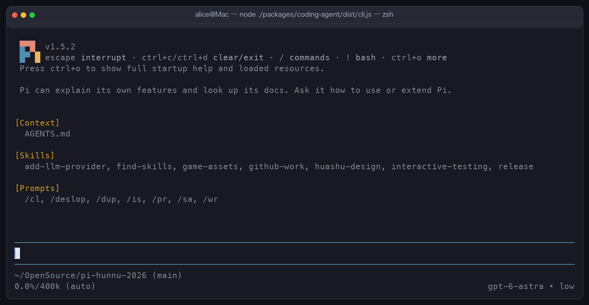
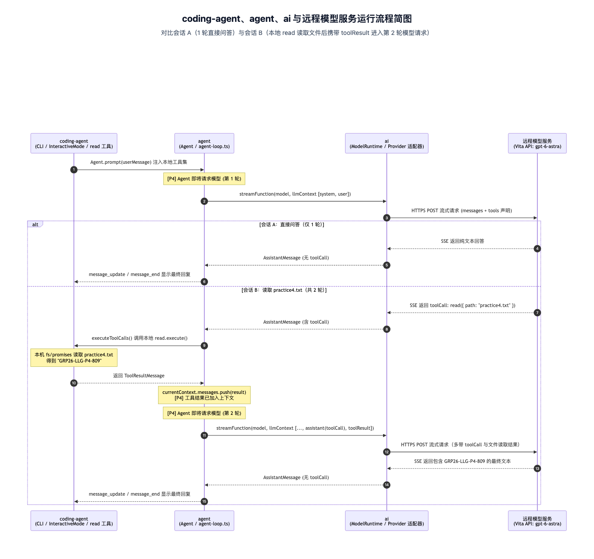
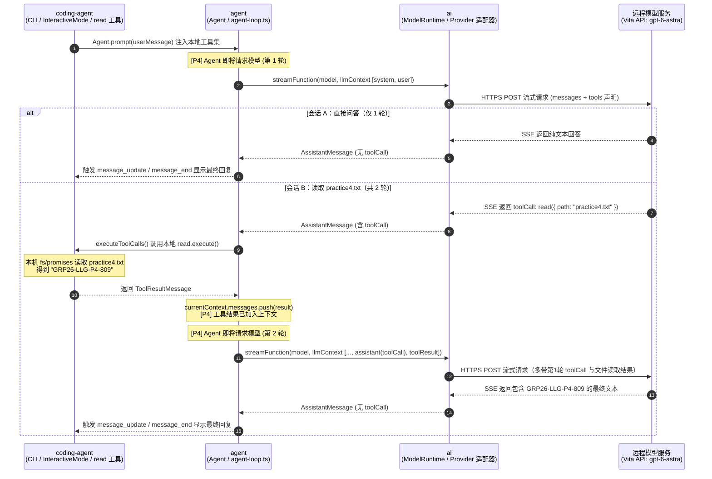

# 实践课 4：Pi Agent 的模型调用与运行流程实验报告

- **小组编号与角色**：第 26 组（组长：刘力阁 `LiuLige`）
- **GitHub 登录名**：`um-rs`
- **小组代码仓库地址**：`https://github.com/WeLikeVibeCoding/pi-hunnu-2026`
- **本地实验目录**：`/Users/alice/OpenSource/pi-hunnu-2026`
- **实验使用模型**：`gpt-6-astra`（Vita API，两次对比会话保持同一模型与同一思考级别 `low`）
- **自定实验代号（`practice4.txt`）**：`GRP26-LLG-P4-809`

---

## 一、源码修改：给 Agent 循环插入两处 `[P4]` 追踪日志

打开 `packages/agent/src/agent-loop.ts`，在不改变任何原有逻辑与参数的前提下插入两处 `console.error` 日志（先修改靠后的第 412 行，再修改第 284 行）：

### 1. 修改位置一：模型流式调用前（`streamAssistantResponse` 函数内）

在原第 412 行 `const response = await streamFunction(config.model, llmContext, {` 正上方插入（插入后位于第 413 行，`await streamFunction(...)` 顺延至第 414 行）：

```ts
	console.error("[P4] Agent 即将请求模型"); // 新增
	const response = await streamFunction(config.model, llmContext, {
```

![S1：agent-loop.ts 第 413 行新增“[P4] Agent 即将请求模型”及其下方的 await streamFunction(...)](images/s1-log-before-stream.png)

### 2. 修改位置二：工具执行结果写入上下文后（`runLoop` 函数 `for` 循环内）

在原第 284 行 `currentContext.messages.push(result);` 正下方插入（每向 `currentContext.messages` 压入一条 `ToolResultMessage` 就打印一次）：

```ts
				for (const result of toolResults) {
					currentContext.messages.push(result);
					console.error("[P4] 工具结果已加入上下文"); // 新增
					newMessages.push(result);
				}
```

![S2：agent-loop.ts 第 283–287 行 for 循环中 currentContext.messages.push(result) 与新增的“[P4] 工具结果已加入上下文”](images/s2-log-after-toolresult.png)

### 3. 完整 `git diff` 核对

```diff
diff --git a/packages/agent/src/agent-loop.ts b/packages/agent/src/agent-loop.ts
index 24497b29b..1260cb7d2 100644
--- a/packages/agent/src/agent-loop.ts
+++ b/packages/agent/src/agent-loop.ts
@@ -281,8 +281,9 @@ async function runLoop(
 				hasMoreToolCalls = !executedToolBatch.terminate;
 
 				for (const result of toolResults) {
 					currentContext.messages.push(result);
+					console.error("[P4] 工具结果已加入上下文"); // 新增
 					newMessages.push(result);
 				}
 			}
 
@@ -408,8 +409,9 @@ async function streamAssistantResponse(
 	// Resolve API key (important for expiring tokens)
 	const resolvedApiKey =
 		(config.getApiKey ? await config.getApiKey(config.model.provider) : undefined) || config.apiKey;
 
+	console.error("[P4] Agent 即将请求模型"); // 新增
 	const response = await streamFunction(config.model, llmContext, {
```

> 注：以上两行实验追踪日志仅在本地完成编译与运行取证，验收取证结束后已还原本地工作区，不向小组共享仓库 `WeLikeVibeCoding/pi-hunnu-2026` 的 `main` 分支推送污染代码。

---

## 二、运行证据：重新编译、启动编译产物与两次会话实测

### 1. 重新编译并检查退出码（S3）

在包含根 `package.json` 的仓库根目录执行 `npm run build`，构建完成后返回终端提示符，紧接着执行 `echo $?`（对应 PowerShell 的 `$LASTEXITCODE`）得到退出码 **`0`**：



### 2. 直接启动编译产物 `dist/cli.js`（S4）

执行 `node ./packages/coding-agent/dist/cli.js` 直接启动重新编译生成的 CLI 产物，成功进入 `pi v1.5.2` 交互界面（所有截图均已隐去授权凭据信息）：



### 3. 会话 A（直接问答）运行记录与截图（S5）

开启新会话，使用模型 `gpt-6-astra`，输入指令：

> `请直接用一句话解释什么是 Git 分支。`

- **是否调用工具**：**否**（未触发任何工具块）。
- **按出现顺序捕获到的 `[P4]` 日志（共 1 条）**：
  ```text
  [P4] Agent 即将请求模型
  ```
- **模型调用轮数**：**1 轮**。
- **Pi 最终回复**：
  > `Git 分支是一条独立的开发线，让你可以在不影响主线代码的情况下开发功能或修复问题，完成后再合并回主线。`

![S5：会话 A（直接问答）输入指令、最终回复与单次“[P4] Agent 即将请求模型”日志](images/s5-session-a-direct.png)

### 4. 会话 B（调用 `read` 工具读取 `practice4.txt`）运行记录与截图（S6）

先在仓库根目录创建 `practice4.txt`，写入本组自定实验代号 `GRP26-LLG-P4-809`（提示词中绝不透露该代号）。开启全新会话，使用同一模型 `gpt-6-astra`，输入指令：

> `请用 read 工具读取当前目录的 practice4.txt，并告诉我文件中的实验代号。`

- **是否调用工具**：**是**，调用了 1 次 `read` 工具读取 `practice4.txt`。
- **按出现顺序完整捕获到的 `[P4]` 日志（共 3 条）**：
  ```text
  [P4] Agent 即将请求模型
  [P4] 工具结果已加入上下文
  [P4] Agent 即将请求模型
  ```
- **模型调用轮数**：**2 轮**。
- **Pi 最终回复**：
  > `文件中的实验代号是：GRP26-LLG-P4-809。`

在交互式 TUI 界面中，第 1 条 `[P4] Agent 即将请求模型` 在工具框渲染刷新时被 TUI 差分重绘覆盖，界面底部清晰保留了循环后半段紧挨着出现的 `[P4] 工具结果已加入上下文` 与第 2 次 `[P4] Agent 即将请求模型`（S6a）；同时将 PTY 原始 `stderr` 日志流按发生顺序完整提取展示如下（S6b），两者完全印证：

![S6a：会话 B 交互界面——read 工具读取 practice4.txt、准确返回代号 GRP26-LLG-P4-809 及底部后半段 [P4] 日志](images/s6-session-b-read.png)

![S6b：会话 B 与会话 A 按真实发生顺序捕获的完整 [P4] stderr 日志流对照](images/s6b-stderr-trace.png)

---

## 三、运行流程对比与核心机制分析

### 1. 两次会话完整对比表

| 对比维度 | 会话 A：直接问答 | 会话 B：读取文件（`practice4.txt`） |
| :--- | :--- | :--- |
| **输入指令** | `请直接用一句话解释什么是 Git 分支。` | `请用 read 工具读取当前目录的 practice4.txt，并告诉我文件中的实验代号。` |
| **是否调用工具** | 否（`toolCalls.length === 0`） | 是（第 1 轮模型返回 `toolCall: read({ path: "practice4.txt" })`） |
| **`[P4]` 日志出现顺序** | `1. [P4] Agent 即将请求模型` | `1. [P4] Agent 即将请求模型`<br>`2. [P4] 工具结果已加入上下文`<br>`3. [P4] Agent 即将请求模型` |
| **进入模型调用轮数** | **1 轮** | **2 轮** |
| **最终回复** | 一句话解释 Git 分支概念 | `文件中的实验代号是：GRP26-LLG-P4-809。` |
| **循环退出原因** | 第 1 轮 `AssistantMessage` 不含 `toolCall`，`hasMoreToolCalls = false`，`runLoop` 直接结束 | 第 1 轮执行工具后 `hasMoreToolCalls = true` 触发第 2 轮模型请求；第 2 轮返回纯文本回答，`hasMoreToolCalls = false`，循环结束 |

### 2. 结合会话 B 的日志与源码回答核心问题

1. **为什么会话 A 只有 1 轮模型调用，而会话 B 进入了 2 轮模型调用？**
   - 在 `agent-loop.ts` 的 `runLoop()` 内层 `while (hasMoreToolCalls || pendingMessages.length > 0)` 循环中，每次迭代都会调用 `streamAssistantResponse()`（打印 `[P4] Agent 即将请求模型`）。
   - 会话 A 中，模型直接具备 Git 分支的通用知识，第 1 次响应只返回 `type: "text"` 内容块，`toolCalls.length === 0`，因此 `hasMoreToolCalls` 被置为 `false`，直接跳出循环（共 1 轮）。
   - 会话 B 中，远程模型并不知道本机磁盘上 `practice4.txt` 里的内容，因此第 1 轮模型调用返回的不是最终答案，而是一个结构化工具调用请求 `toolCall`（工具名 `read`，参数 `{ "path": "practice4.txt" }`）。`runLoop()` 检测到 `toolCalls.length > 0`，执行本地工具并将结果 `push` 进 `currentContext.messages`（打印 `[P4] 工具结果已加入上下文`），同时令 `hasMoreToolCalls = !executedToolBatch.terminate`（为 `true`），驱动 `while` 循环进入第 2 轮，再次打印 `[P4] Agent 即将请求模型` 把工具结果发给模型生成最终回答。

2. **到底是谁实际读取了 `practice4.txt` 文件？**
   - **是运行在本机上的 `coding-agent` 本地进程中的 `read` 工具（`packages/coding-agent/src/core/tools/read.ts`），而不是远程大模型服务器！**
   - 远程大模型自始至终无法直接访问本机文件系统；它所做的仅仅是在第 1 轮响应中输出一段 JSON 描述（“我请求调用名为 `read` 的工具，参数 `path` 为 `practice4.txt`”）。真正打开本地文件句柄并调用 Node.js `fs/promises` 读取出 `GRP26-LLG-P4-809` 字节流的，是 `agent-loop.ts` 的 `executeToolCalls()` 回调本机 `coding-agent` 注册的 `read` 工具 `execute()` 函数。

3. **会话 B 的第 2 轮模型请求比第 1 轮多带了什么内容？**
   - 结合 `agent-loop.ts` 第 428/457 行与第 284 行源码可知，第 2 轮调用 `streamFunction(config.model, llmContext, ...)` 时，`currentContext.messages`（转换后即 `llmContext.messages`）比第 1 轮**多带了两条关键消息**：
     1. **第 1 轮模型的 `assistant` 消息（含 `toolCall` 块）**：记录模型刚刚发出的 `read({ path: "practice4.txt" })` 调用及 `toolCallId`；
     2. **紧接着在 `for (const result of toolResults)` 中压入的 `toolResult` 消息（`ToolResultMessage`）**：关联同一个 `toolCallId` 和 `toolName: "read"`，其 `content` 中装着本机刚从 `practice4.txt` 读出的真实文本 `"GRP26-LLG-P4-809"`。
   - 正是因为第 2 轮请求上下文里多带了这两条消息（尤其是包含 `GRP26-LLG-P4-809` 的 `toolResult`），无状态的远程大模型才能在第 2 轮“看到”文件内容并准确说出实验代号。

### 3. `coding-agent`、`agent`、`ai` 与远程模型服务协作简图

- 可编辑 Mermaid 图源文件：[runtime-flow.mmd](runtime-flow.mmd)




