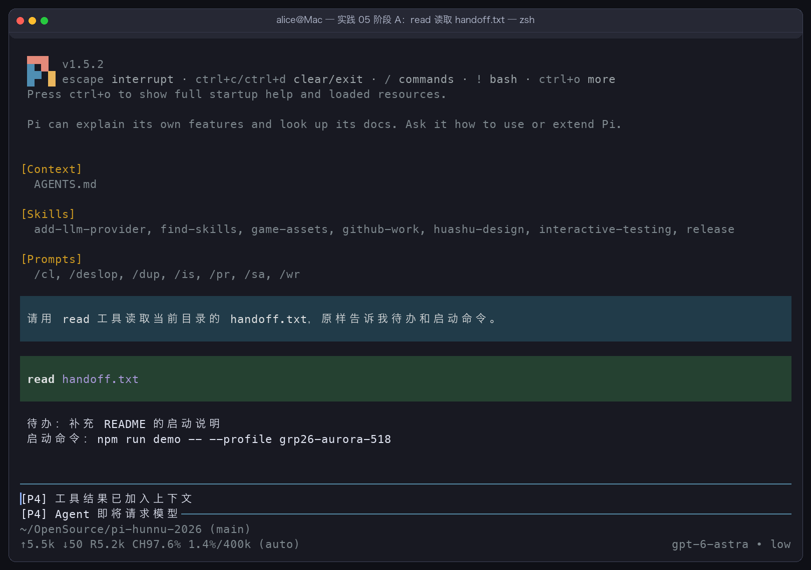
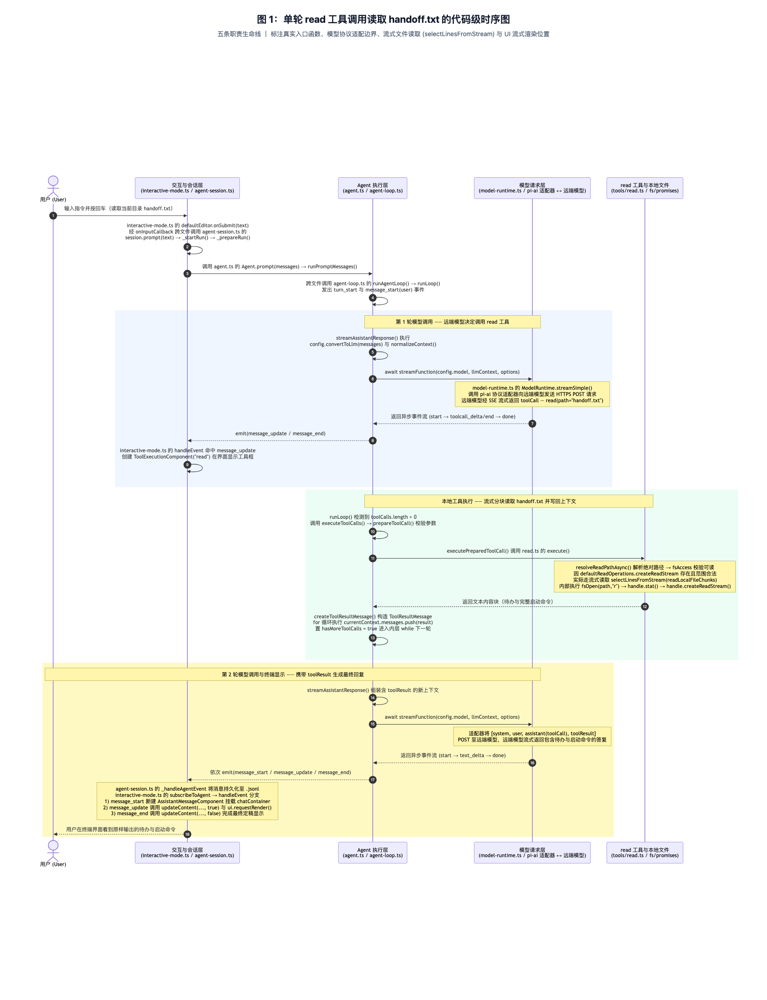
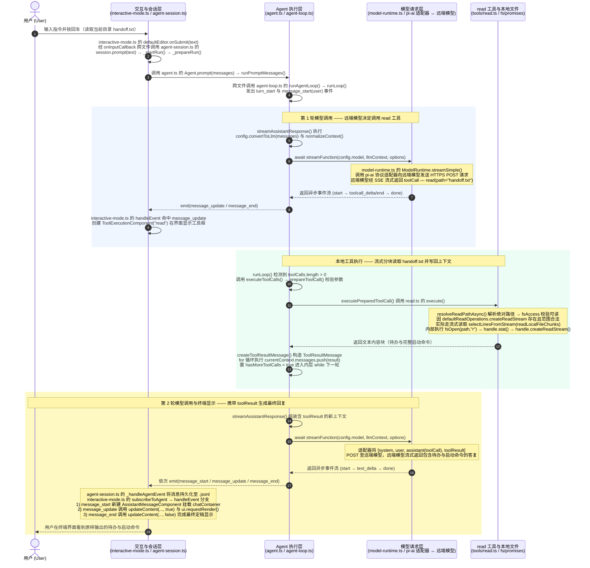
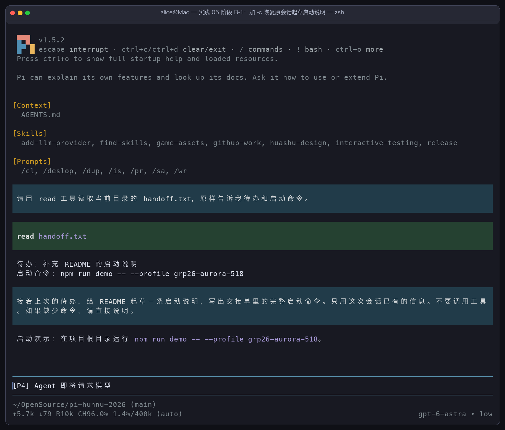
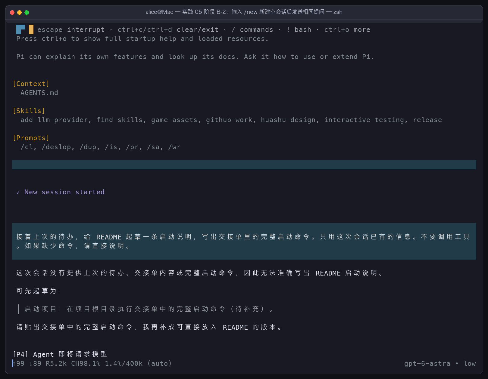
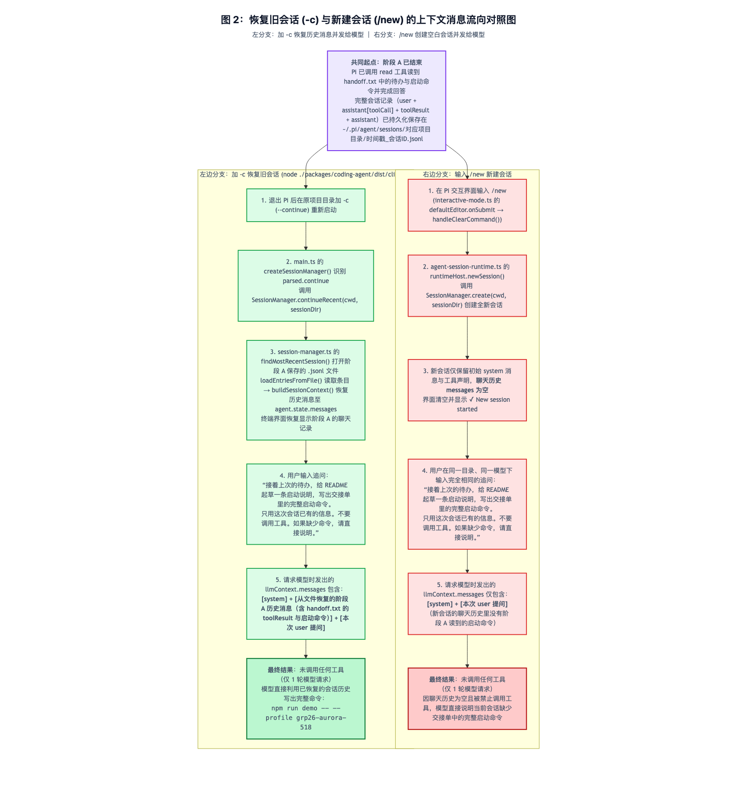
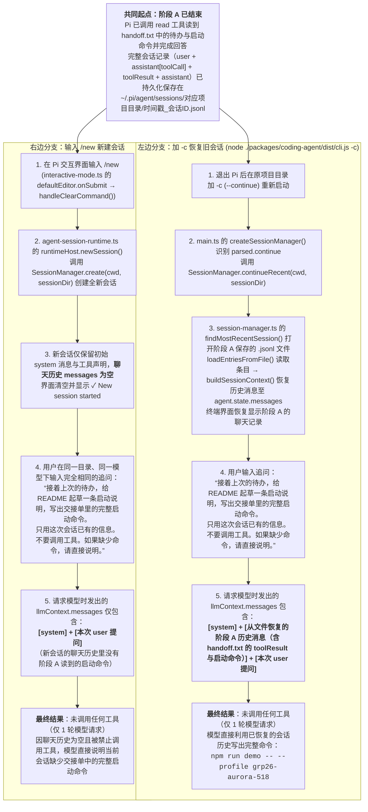

# 实践 05｜Pi Agent 源码泛读与功能定位实验报告

- **小组编号与角色**：第 26 组（组长：刘力阁 `LiuLige`）
- **GitHub 登录名**：`um-rs`
- **小组代码仓库地址**：`https://github.com/WeLikeVibeCoding/pi-hunnu-2026`
- **实际 Clone 地址**：`https://github.com/WeLikeVibeCoding/pi-hunnu-2026.git`
- **实验使用模型**：`gpt-6-astra`（Vita API，阶段 A、阶段 B-1、阶段 B-2 全程使用同一目录与同一模型）
- **本组随机交接标识（`handoff.txt`）**：`grp26-aurora-518`

---

## 一、阶段 A：单轮交互与 `read` 工具调用（实操证据与代码级时序图）

### 1. 实验过程与运行结果

在本地构建的 `pi-hunnu-2026` 工作目录中创建交接文件 `handoff.txt`，写入以下两行内容（包含第 26 组随机生成的启动标识 `grp26-aurora-518`，在提问提示词中绝不透露）：

```text
待办：补充 README 的启动说明
启动命令：npm run demo -- --profile grp26-aurora-518
```

启动本地构建的 Pi（`node ./packages/coding-agent/dist/cli.js`），在新会话中输入指令：

> `请用 read 工具读取当前目录的 handoff.txt，原样告诉我待办和启动命令。`

实测观察记录：
- **交互轮数与模型调用次数**：1 轮用户输入内共发生了 **2 次模型调用**、**1 次本地 `read` 工具调用**（`[P4]` 日志严格按 `Agent 即将请求模型 → 工具结果已加入上下文 → Agent 即将请求模型` 顺序出现）。
- **Pi 实际回复**：
  ```text
  待办：补充 README 的启动说明
  启动命令：npm run demo -- --profile grp26-aurora-518
  ```
- **持久化会话文件落盘验证**：阶段 A 完成后，会话管理器自动在会话目录下持久化生成了 `.jsonl` 文件（`2026-11-26T07-12-32-429Z_01a216b2-e4ac-7220-a91a-777164b8df21.jsonl`），依次写入了 `session` 头、`model_change`、`thinking_level_change` 以及 `system`、`user`、`assistant(toolCall)`、`toolResult`、`assistant` 消息条目。



---

### 2. 图 1：单轮工具调用的代码级时序图（五条职责生命线）

结合源码对阶段 A 这一轮交互做完整代码级追踪，核实关键边界与具体实现位置如下：

1. **用户输入入口（`packages/coding-agent/src/modes/interactive/interactive-mode.ts`）**：
   - 第 3325 行 `setupEditorSubmitHandler()` 为编辑器注册 `this.defaultEditor.onSubmit = async (text: string) => { ... }`。
   - 排除斜杠命令与 `!` 命令后，在第 3516–3519 行触发 `this.onInputCallback(text)`（唤醒 `getUserInput()`），跨文件进入 `packages/coding-agent/src/core/agent-session.ts` 第 2175 行 `AgentSession.prompt(text)` → 第 1956 行 `_startRun()` → `_prepareRun()`。
2. **启动 Agent 循环（`packages/agent/src/agent.ts` → `agent-loop.ts`）**：
   - `agent-session.ts` 第 1982 行调用 `await this.agent.prompt(messages)`（定义于 `packages/agent/src/agent.ts` 第 382 行）。
   - `Agent.prompt()` 将文本规范化为 `user` 消息后调用 `runPromptMessages()`（第 441 行），跨文件进入 `packages/agent/src/agent-loop.ts` 第 111 行 `runAgentLoop()` → 第 172 行核心循环 `runLoop()`。
3. **模型请求层边界（`agent-loop.ts` → `model-runtime.ts` → `packages/ai` 协议适配器 ↔ 远端模型）**：
   - `runLoop()` 第 251 行调用 `streamAssistantResponse()`：经 `config.convertToLlm(messages)` 与 `normalizeContext()` 组装请求上下文后，在第 412 行执行 `await streamFunction(config.model, llmContext, ...)`。
   - 该函数对接 `packages/coding-agent/src/core/model-runtime.ts` 第 744 行 `ModelRuntime.streamSimple()`，再委托给 `packages/ai/src/providers/` 下的对应协议适配器（本实验自定义接口走 OpenAI 兼容流式适配器 `openai-completions.ts`），向远端模型服务发起 HTTPS POST 流式请求并解析 SSE 事件流。第 1 轮远端返回 `toolCall: read({ path: "handoff.txt" })`，第 2 轮携带 `toolResult` 后远端流式返回最终文本。
4. **`read` 工具与文件系统调用边界——核对源码确认走“流式分块读取”而非整文件缓冲区读取（`packages/coding-agent/src/core/tools/read.ts`）**：
   - `agent-loop.ts` 第 279 行 `executeToolCalls()` 经 `prepareToolCall()`（调用 `pi-ai` / `pi-schema` 校验参数）后进入 `tools/read.ts` 第 245 行的 `execute()`。
   - 先由 `resolveReadPathAsync()` 解析出绝对路径，调用 `await ops.access(absolutePath)`（`fsAccess(path, constants.R_OK)`）确认可读，再用 `detectImageMimeType` 判定 `handoff.txt` 为非图片文本文件。
   - **关键源码核对（第 68–92 行与第 300–308 行）**：默认本地操作对象 `defaultReadOperations` 同时提供了 `createReadStream: readLocalFileChunks` 与 `readFile: (path) => fsReadFile(path)`。在第 301 行分支判断：
     ```ts
     ops.createReadStream && isStreamableRange(offset, limit)
         ? await selectLinesFromStream(ops.createReadStream(absolutePath, { signal }), startLine, limit, signal)
         : selectLinesFromBuffer(await ops.readFile(absolutePath), startLine, limit);
     ```
     当读取 `handoff.txt`（未传特殊负数/小数 `limit`，`isStreamableRange(undefined, undefined)` 为 `true`）时，**实际走的是流式分块读取路径 `selectLinesFromStream(readLocalFileChunks(absolutePath))`**：`readLocalFileChunks`（第 81–92 行）执行 `const handle = await fsOpen(path, "r")` → `await handle.stat()` → `yield* handle.createReadStream({ end: stats.size - 1, autoClose: false })`，由 `TextDecoder` 按流式 chunk 逐行解码截取（防止超大文件撑爆内存）；只有图片文件或未实现 `createReadStream` 的自定义后端才会回退到 `selectLinesFromBuffer(await ops.readFile(...))` 缓冲区整文件读取。
5. **终端显示回复的位置（回到 `interactive-mode.ts` 会话订阅分支）**：
   - `interactive-mode.ts` 第 3525 行 `subscribeToAgent()` 通过 `this.session.subscribe((event) => this.handleEvent(event))` 订阅会话事件（底层 `agent-session.ts` 的 `_handleAgentEvent` 同时把完成的条目追加持久化到 `.jsonl`）：
     - 第 3633 行 `case "message_start"`（当 `role === "assistant"`）：创建 `new AssistantMessageComponent(...)` 并 `this.chatContainer.addChild(this.streamingComponent)`；
     - 第 3649 行 `case "message_update"`：调用 `this.streamingComponent.updateContent(this.streamingMessage, true)`（若含 `toolCall` 则创建/更新 `ToolExecutionComponent`），随后调用第 3681 行 `this.ui.requestRender()` 将增量文本实时渲染到终端屏幕；
     - 第 3685 行 `case "message_end"`：调用第 3698 行 `this.streamingComponent.updateContent(this.streamingMessage, false)` 完成最终 Markdown 定稿渲染并清空 `this.streamingComponent`——**这就是用户在界面上看到完整最终回复的确切代码位置**。

- 独立可编辑图源文件：[fig1-read-sequence.mmd](fig1-read-sequence.mmd)





---

## 二、阶段 B：恢复上次会话（`-c`）与新建会话（`/new`）对比实验及源码定位

### 1. 两种情况实操对比记录

阶段 A 结束后退出 Pi，在同一个项目目录 `/Users/alice/OpenSource/pi-hunnu-2026`、使用同一个模型 `gpt-6-astra`，向两种会话输入**一字不差的相同提示词**：

> `接着上次的待办，给 README 起草一条启动说明，写出交接单里的完整启动命令。只用这次会话已有的信息。不要调用工具。如果缺少命令，请直接说明。`

#### （1）情况一：加 `-c`（`--continue`）恢复原会话

执行 `node ./packages/coding-agent/dist/cli.js -c` 重新启动后，终端直接重绘展示了阶段 A 的完整聊天记录。发送上述提示词后：
- **是否调用工具**：**否**（未出现任何工具调用块，`[P4]` 仅打印 1 次 `[P4] Agent 即将请求模型`）。
- **状态栏输入 Token 证据**：底部状态栏显示输入上下文 `↑5.7k`（包含阶段 A 恢复出的历史消息与 `toolResult`）。
- **Pi 实际回答**：
  > `启动演示：在项目根目录运行 npm run demo -- --profile grp26-aurora-518。`
- **结论验证**：在完全未重新调用 `read` 工具的前提下，Pi 准确写出了阶段 A 交接单里的随机标识命令 `npm run demo -- --profile grp26-aurora-518`，直接证明它使用了从磁盘恢复的会话历史消息。



#### （2）情况二：输入 `/new` 开启新建会话

在同一目录、同一模型下输入 `/new`（界面清空并提示 `✓ New session started`），随后输入完全相同的提示词：
- **是否调用工具**：**否**（同样无工具调用，仅 1 次 `[P4] Agent 即将请求模型`）。
- **状态栏输入 Token 证据**：底部状态栏非缓存新增输入仅 `↑99`（仅含本次提问文本，无阶段 A 对话历史）。
- **Pi 实际回答**：
  > `这次会话没有提供上次的待办、交接单内容或完整启动命令，因此无法准确写出 README 启动说明。`
  > `可先起草为：`
  > `| 启动项目：在项目根目录执行交接单中的完整启动命令（待补充）。`
  > `请贴出交接单中的完整启动命令，我再补成可直接放入 README 的版本。`
- **对照总结表**：

| 对比项 | 恢复旧会话（`-c` / `--continue`） | 新建会话（`/new`） |
| :--- | :--- | :--- |
| **会话初始化入口** | `SessionManager.continueRecent(cwd, sessionDir)` | `runtimeHost.newSession()` → `SessionManager.create(cwd, sessionDir)` |
| **是否调用工具** | **否**（0 次工具调用，1 轮模型请求） | **否**（0 次工具调用，1 轮模型请求） |
| **发给模型的历史上下文** | 含阶段 A 恢复的 `user`、`assistant(toolCall)`、`toolResult(handoff.txt)`、`assistant` + 本次提问 | 仅初始 `system` 消息 + 本次提问（历史为空） |
| **实际回答结果** | 准确写出 `npm run demo -- --profile grp26-aurora-518` | 明确说明当前会话缺少交接单内容与完整启动命令 |



---

### 2. 图 2：恢复旧会话和新建会话的对照图（结合源码路径）

对应到 `coding-agent` 源码，两条分支的关键差异发生在 `SessionManager` 构造与上下文投影阶段：
- **左分支（`-c` 恢复旧会话）**：`packages/coding-agent/src/main.ts` 的 `createSessionManager()` 在解析到 `-c`（`parsed.continue === true`）时，调用 `packages/coding-agent/src/core/session-manager.ts` 第 1811 行的 `SessionManager.continueRecent(cwd, sessionDir)` → `findMostRecentSession()` 找到阶段 A 保存的最新 `.jsonl` 文件 → 第 628 行 `loadEntriesFromFile()` 按行解析全部 JSON 条目 → 第 577 行 `buildSessionContext()` 沿着会话树叶子节点还原出包含 `handoff.txt` 读取结果在内的 `messages` 数组并注入 `AgentSession` 的 `this.agent.state.messages`。因此下一次提问时，阶段 A 的历史消息与本次提问一并进入 `llmContext.messages` 发给模型。
- **右分支（`/new` 新建会话）**：`interactive-mode.ts` 第 3429 行 `if (text === "/new")` 调用第 7117 行 `handleClearCommand()` → `packages/coding-agent/src/core/agent-session-runtime.ts` 第 226 行 `newSession()` → 调用 `SessionManager.create(this.cwd, sessionDir)`（`session-manager.ts` 第 1773 行）构造内存条目为空的新会话实例，替换当前 `AgentSession` 并重绑 UI。此时 `agent.state.messages` 中只有初始 `system` 提示词，没有任何阶段 A 的消息，模型收到的请求中自然不包含 `handoff.txt` 的启动命令。

- 独立可编辑图源文件：[fig2-session-compare.mmd](fig2-session-compare.mmd)




